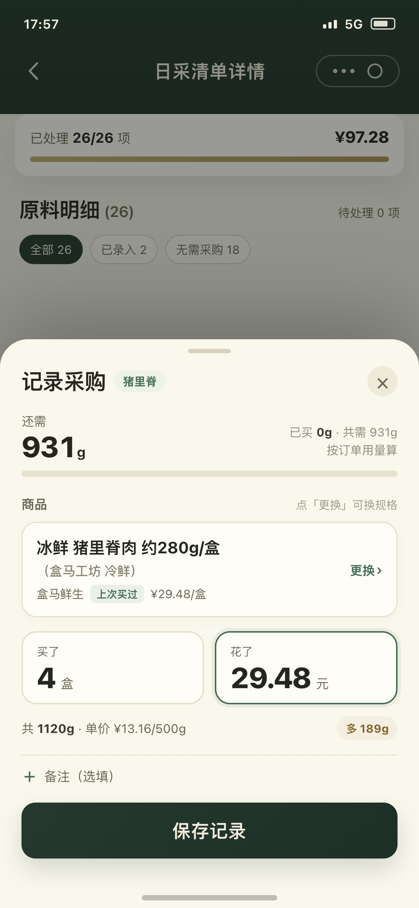
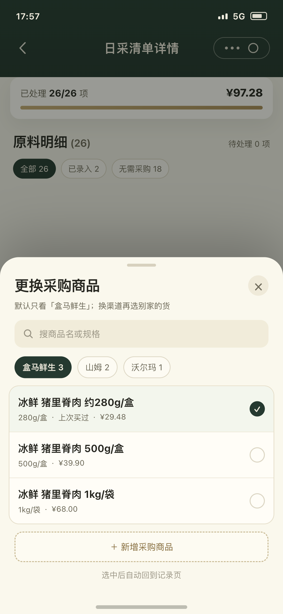
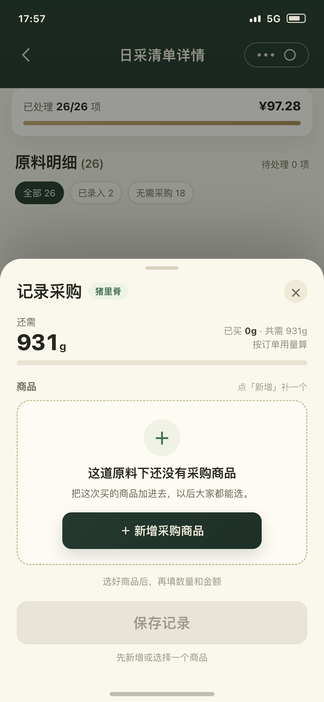
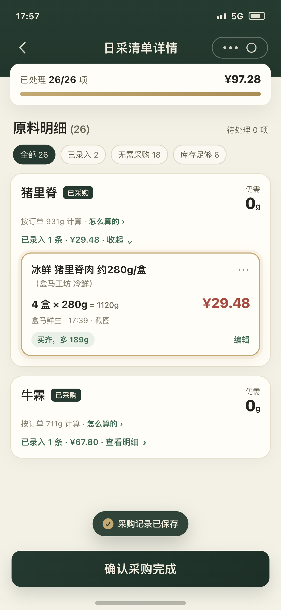

# 采购记录弹窗优化方案

- 日期：2026-11-06
- 范围：员工端「日采清单详情 → 采购记录」弹窗（添加 / 编辑）
- 状态：已实现（2026-11-07，小程序员工端）
- 原型：`mockups/purchase-record-modal-ux/index.html`
- 截图：`mockups/purchase-record-modal-ux/shots/`

## 1. 目标

一句话：让员工在货架前，3 秒内把“买了什么、几个、多少钱”记完，并且记完马上知道“够不够”。

三个可验收的目标：

1. 只有一个商品时，不滚动就能完成录入。
2. 商品名、规格、渠道、数量、金额、结果，一屏内按顺序看完。
3. 保存后 2 秒内看到新记录，以及“买齐 / 多多少 / 还差多少”。

## 2. 现状问题（从用户角度）

1. **主次反了**：最上面是订单需求、库存抵扣（背景），最下面是数量和金额（正事）。
2. **重复**：“仍需”和“余量/缺口”两个口径；“历史单价”在商品卡和价格区各一次；“已预填上次采购习惯”和选中的商品重复。
3. **商品选择太重**：每个商品一张卡（推荐/可替换、名字、渠道、规格、历史单价、勾选），3 个商品占半屏，输入框被推到第一屏下面。
4. **出口太多**：右上角 ×、底部取消、点空白，三个关闭入口；取消和保存一样大。
5. **换商品不重算**：规格从 280g 换成 1kg，数量和金额还是旧的。
6. **预填上次数量**：容易顺手存成上次的数。
7. **保存后看不到**：弹窗关闭，记录卡不一定展开，刚存的那条可能看不见。
8. **缺渠道是死路**：只弹“联系管理员”，没有“去补全”的入口。
9. **商品没按渠道过滤**：盒马的单子里能选到山姆的同名货。
10. **校验一条条弹**：没有输入框下面的红字，填错要一次次点。

## 3. 设计原则

1. 一屏只做一件事：记这一笔。
2. 一条信息只说一次。
3. 一个屏幕一个实心按钮。
4. 名字和数字是主角；渠道、规格、时间往后退。
5. 保存后必须看到结果；有改动必须确认。

## 4. 新结构（一屏五块）

| 顺序 | 区块 | 内容 | 作用 |
|---|---|---|---|
| 1 | 进度 | 还需 931g；已买 0g · 共需 931g；进度条 | 知道还差多少 |
| 2 | 商品 | 名字两行；括号品牌第二行小字；渠道 · 上次买过 · 上次单价；更换 | 知道买的是什么 |
| 3 | 输入 | 买了 4 盒；花了 29.48 元 | 记这一笔 |
| 4 | 结果 | 共 1120g · 单价 ¥13.16/500g；多 189g | 知道买完够不够 |
| 5 | 底部 | 保存记录；备注折叠 | 保存后回清单 |

对应原型图 1：

## 5. 细则

### 5.1 顶部进度

- “共需” = 清单生成时的目标缺口（`purchaseShortageQuantity` / `quantityNeeded`），不是订单总需求；库存抵扣不进入这个分母。
- “已买” = 已有采购记录折算量；“还需” = max(0, 共需 - 已买)。
- 编辑一条旧记录时，这条记录要覆盖“还需 + 这条旧记录”，避免重复扣减。
- 进度条 = 已买 / 共需；超过 100% 用琥珀色，不显示负数。
- 不再放“订单需求 / 库存抵扣”；这两项收进页面上的“怎么算的”。

### 5.2 商品

- 只有一个商品：直接展示，不出现列表。
- 多个商品：点“更换”打开选择面板。
- 名字：主行最多两行；括号里的品牌/系列单独一行、灰色小字；不省略、不藏。
- 副行：渠道 · 上次买过 · 上次单价。
- 选择面板：
  - 默认当前渠道；顶部可切换盒马 / 山姆 / 沃尔玛。
  - 搜索商品名或规格。
  - 每行：两行名字 + 规格/渠道 + 上次买过/价格；选中即回。
  - 底部“＋ 新增采购商品”。

对应原型图 2：

**换商品规则**：

- 换商品一律清空数量和金额，回来重新填。
- 选择面板底部写明“换商品后，数量和金额要重填”，避免员工以为接着上一件算。
- 清空后把光标放到“买了”，不弹二次确认（点“更换”就是明确要换）。
- 如果只是点开看看、又选回原商品，不清空。

### 5.2.1 没有匹配商品时（空态）

- **两个入口**：
  1. 商品选择面板：搜不到时，底部“＋ 新增采购商品”。
  2. 这道原料下没有任何商品：弹窗里直接显示空态卡 + “＋ 新增采购商品”。
- **空态文案**：
  - 标题：“这道原料下还没有采购商品”
  - 说明：“把这次买的商品加进去，以后大家都能选。”
  - 空态按钮：“＋ 新增采购商品”
- 数量/金额先不显示，提示“选好商品后，再填数量和金额”；底部“保存记录”置灰，提示“先新增或选择一个商品”。
- 新增页返回：自动选中新商品，回到这个弹窗；商品规格/单位带回来，数量和金额为空，光标落在“买了”。
- 非食材（补剂/包材）不开放新增：空态改成“请联系管理员在后台新增”，不给按钮。

对应原型图 4：

### 5.3 数量 / 金额

- 并排，数字大；单位跟在数字后。
- 数量用采购单位（盒/袋/瓶），最多 3 位小数；金额 2 位。
- 校验：必填、大于 0、位数；错误在输入框下红字，不用弹窗。
- 预填：新增时商品、渠道、上次单价可以预填；**数量不预填，金额不预填**；编辑时全部回填。
- 键盘：数字键盘；底部按钮跟着键盘上移；输入框滚到可见。

### 5.4 结果行

- 文案：`共 1120g · 单价 ¥13.16/500g`；右侧 `多 189g / 还差 125g / 刚好买齐`。
- 颜色：多 = 琥珀，还差 = 红，刚好 = 绿。
- 单价口径沿用现有：g/ml 按 500g/500ml，其他按 1 个单位。
- 历史价只在商品行出现一次；差价超过 20% 时，结果行加一句“比上次贵 18%”。

### 5.5 备注

- 默认折叠成一行“＋ 备注（选填）”；点开 2 行输入；最多 200 字。

### 5.6 底部

- 只保留一个主按钮，整行：“保存记录”；编辑时“保存修改”。
- 保存后关闭弹窗、回到清单；不再放“保存并再记一条”（一个原料偶尔才记多条，需要时再点该原料的“采购记录”）。
- 关闭：右上角 ×；有改动时确认“放弃这次填写？”；点遮罩同样确认。
- 保存中：按钮显示“保存中…”，禁止关闭和重复提交。

## 6. 状态与反馈

| 场景 | 行为 |
|---|---|
| 打开 | 默认选中上次商品/推荐商品；数量空、金额空；显示“上次买过” |
| 编辑 | 标题“修改采购记录”；副标题“11-06 17:39 · 盒马鲜生”；预填全部字段；主按钮“保存修改” |
| 保存成功 | 关闭 → 回到清单 → 自动展开该原料 → 新记录高亮 2 秒 → 顶部“已录入 N 条 · ¥”更新 → 浮层提示 |
| 保存失败 | 保留弹窗；字段下方或顶部提示；不关闭 |
| 缺渠道/单位 | 商品行内提示“这个商品缺渠道，保存前请让管理员在后台补全”；不再只弹“联系管理员” |
| 没有商品 | 显示空态卡 + “＋ 新增采购商品”；数量/金额先不显示；保存置灰 |
| 新增返回 | 自动选中新商品，回到弹窗；数量/金额为空，光标落在“买了” |
| 商品被停用 | 编辑时提示“原商品已停用，请重新选择”；保留数量/金额，商品空 |
| 慢网 | 按钮“保存中…”，防重复提交 |

## 7. 记录卡联动（保存后看到的那张）

- 第一层：名字两行；括号品牌第二行灰色；右上角“···”。
- 第二层：`4 盒 × 280g = 1120g`；`¥29.48`。
- 第三层：渠道 + 状态 + 编辑：`盒马鲜生` `买齐，多 189g` `编辑`。
- 时间、来源、删除收进“···”菜单；卡片不再单起一行写“17:39 · 截图”。截图大图入口暂未接（记录接口没有可直接预览的地址）。
- 保存后自动展开 + 高亮；卡片顶部“已录入 N 条”同步。
- 原料行的“订单 / 现有 / 抵扣”收进“怎么算的 ›”，默认只留“仍需”。
- 状态、剩余、记录入口各司其职，不再加“库存足够，无需购买”这种解释句。

对应原型图 3：

## 8. 文案对照

| 位置 | 现在 | 改成 |
|---|---|---|
| 标题 | 添加采购记录 | 记录采购 |
| 任务卡 | 采购任务 | 删 |
| 任务卡 | 已预填上次采购习惯 | 上次买过（商品行） |
| 指标 | 订单需求 / 库存抵扣 | 删（收进“怎么算的”） |
| 指标 | 仍需采购 | 还需 |
| 商品卡 | 可替换 | 删 |
| 价格区 | 历史单价 | 删（商品行保留一次） |
| 结果 | 余量 / 缺口 | 买完多 189g / 买完还差 125g |
| 底部 | 取消 | 删（保留 ×） |
| 底部 | 保存 | 保存记录 |
| 底部 | 保存并再记一条 | 删（默认回清单） |
| 记录卡 | 已采购 + 仍需 0g + 已录入 1 条 | 状态 + 剩余 + 记录入口（不加解释句）|
| 记录卡 | 订单 931g · 现有 6990kg · 抵扣 931g | 按订单 931g 计算 · 怎么算的 › |
| 记录卡 | 盒马鲜生 · 17:39 · 截图 | 盒马鲜生 + 状态；时间/截图进“···” |

## 9. 验收标准

1. 1 个商品：打开 → 看到还需、商品、两个输入、结果、保存，全程不滚动。
2. 3 个商品：换商品 1 次点击进入面板；输入仍在首屏。
3. 名字在弹窗里按两行展示，不被按钮挤成省略号；括号品牌单独一行。
4. 保存后回到清单，2 秒内看到新记录、高亮、状态一句话。
5. 换商品一律清空数量和金额；选回原商品不清空。
6. 有改动关闭有确认；保存中不能重复提交。
7. 缺渠道有明确提示；没有商品有“新增采购商品”入口。
8. 键盘弹起时底部按钮和输入框都可见。
9. 空态新增返回后自动选中新商品，数量和金额为空。
10. 已有 1 条 / 2 条记录、编辑旧记录、库存抵扣四种情况下，还需、结果行、记录卡状态都正确（由 `record-math.spec.ts` 覆盖）。

## 10. 不在本期

- 商品名数据清洗 / AI 口径（已单独确认，本期不动）。
- 采购完成、报销流程。
- 价格提醒算法调整。
- 原料行整体信息架构（只做“订单/现有/抵扣”的收纳）。

## 11. 本轮已定（2026-11-06）

1. 一个原料偶尔才记多条：保存后默认回清单，不做“再记一条”。
2. 换商品：一律清空数量和金额，重新填。
3. 没有匹配商品：给“新增采购商品”入口（空态 + 选择面板底部）。
4. 记录卡：时间、截图收进“···”；渠道保留在卡片上，保持精简。

## 12. 实现备注（2026-11-07）

已落地（`miniapp/` 员工端日采清单详情）：

- 弹窗改成一屏五块：进度 → 商品 → 数量/金额 → 结果 → 保存；去掉订单需求、库存抵扣、采购任务、可替换、重复历史价和取消按钮。
- 商品多时才展开「更换」面板：按当前渠道过滤、支持搜索、底部可新增；换商品一律清空数量和金额。
- 保存后回清单，自动展开该原料、高亮新记录，并在顶部同步“已录入 N 条”。
- 没有商品时有空态卡 +「＋ 新增采购商品」；新增返回后自动选中新商品。
- 记录卡精简为名字、数量金额、渠道 + 状态 + 编辑；时间、来源、删除收进「···」；数量行补回 `= 1120g` 折算总量。
- 商品名里的括号品牌/系列拆到第二行小字。
- 进度/结算改为纯函数 `record-math.ts`：共需用目标缺口，还需 = max(0, 共需 - 已买)；编辑时加上旧记录；库存抵扣不进入进度分母。
- 只有一个商品时也能打开「更换」面板，从而能走到「新增采购商品」。
- 保存中禁止关闭和重复提交；编辑时原商品被停用会提示重新选择，不会变成新增一条。
- 保存后只高亮刚存的那一条记录，并在页面卸载时清掉高亮定时器。

本期没做：

- 原料行的“订单 / 现有 / 抵扣”收进“怎么算的”（下一步）。
- 现有商品缺渠道/单位时，员工端没有编辑入口，只能提示管理员在后台补全（现有新增页只能新建，不能改旧）。
- 记录卡「···」里的截图大图预览：记录接口目前没有返回可直接预览的地址，先显示“来源：截图识别”。
