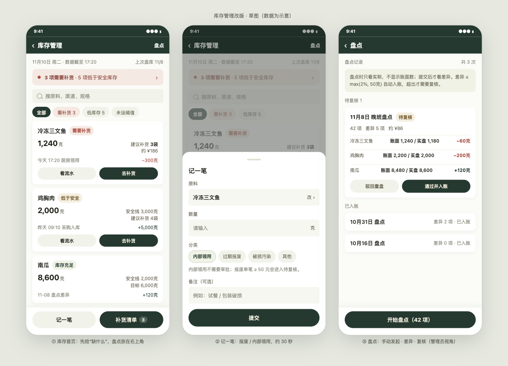
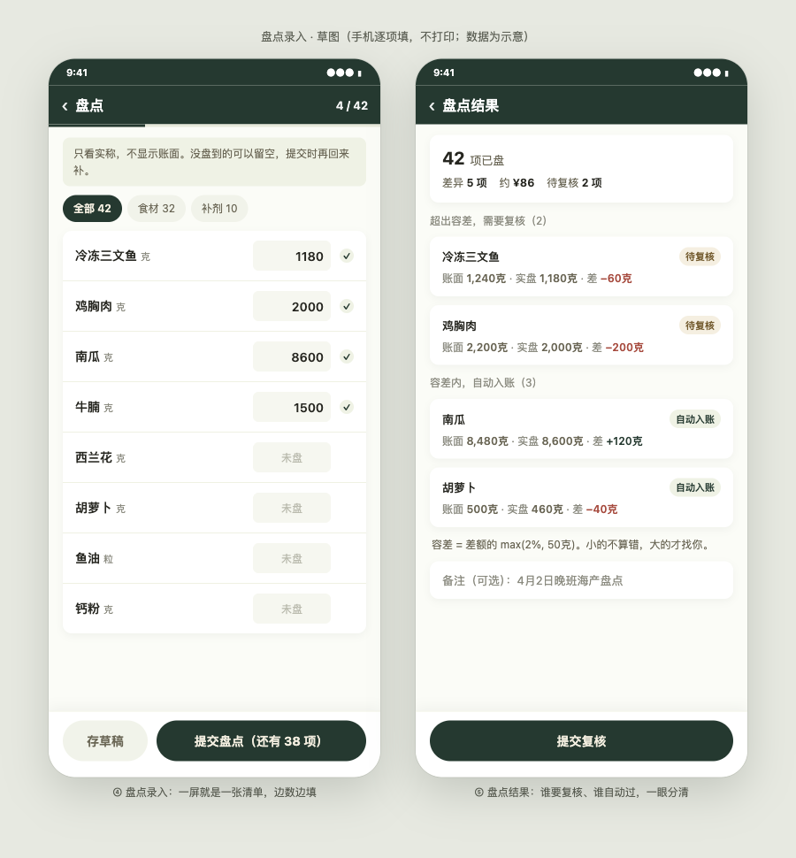

# 库存管理改版 · 独立审核材料包

> 2026-11-10 · 这份文件是给**下一轮独立评审**用的入口：先看它，再按顺序看材料。

## 1. 这次要解决什么

小程序工作台的库存模块，页面能查、能盘、能补货，但**账面数字本身不可信**：

- 日采原料完全不进账；
- 出库有两套口径同时在跑，一套默认关、一套只扣「从库存抵扣的那部分」；
- 没有操作人、没有复核，流水还能被删。

结果是「买多少 − 用多少 = 还有多少」这条公式在系统里算不出来。
这次先把账修对，再谈界面。

## 2. 材料清单

| # | 文件 | 是什么 |
|---|---|---|
| 1 | [`01-台账与盘点方案.md`](01-台账与盘点方案.md) | 台账与盘点方案：七个动作、四条原则、三期落地、老板拍板的决定、我的判断 |
| 2 | [`02-界面与交互设计.md`](02-界面与交互设计.md) | 界面与交互：五屏结构、盲盘、容差、草稿、排序规则 |
| 3 | [`03-实施计划.md`](03-实施计划.md) | **完整实施计划**：三期共 21 个任务，含文件、接口、测试、上线顺序与验收 |
| 4 | [`prototypes/inventory-ledger-ui-2026-11-10.png`](prototypes/inventory-ledger-ui-2026-11-10.png) | 原型图（3 屏）：库存首页 / 记一笔 / 盘点记录 · HTML 同目录 |
| 5 | [`prototypes/inventory-stocktake-ui-2026-11-10.png`](prototypes/inventory-stocktake-ui-2026-11-10.png) | 原型图（2 屏）：盘点录入 / 盘点结果 · HTML 同目录 |

阅读顺序：**原型图（先看图）→ 01 → 03 → 02**。
01 是方案，03 是实施计划，02 是界面与交互；计划里的 T11–T15 就是 02 的落地任务，原型图是 02 的视觉版。

## 3. 原型图（五屏）

**① 库存首页 / ② 记一笔 / ③ 盘点记录**

**④ 盘点录入 / ⑤ 盘点结果**

五屏分别对应界面文档 §3–§5；HTML 源文件在 `prototypes/` 下，可直接在浏览器打开。

## 4. 审核请重点看这几处

1. **出库口径是否真的收敛成一条**：方案要求「食材/补剂按配方理论用量、包材按包装数量」，预占只占用不扣账。计划 Task 2 是否把第二条通道彻底关掉？会不会在别处还有第三个写流水的地方？
2. **一期做完之后，账面会不会仍然偏**：日采入库 + 完工扣料 + 期初盘点三件事的顺序是否闭环；上线顺序（先部署、再期初、最后开开关）有没有漏洞。
3. **冲红方案是否幂等**：同一张采购单反复「完成/撤回」，余额是否稳定（计划 Task 4）。
4. **操作人是否覆盖到每一笔**：计划只补了盘点/调整/完工，采购入库靠什么记人？是否够用。
5. **计划的测试是否真的能证明行为**：每个任务的断言能否在实现前失败、实现后通过。
6. **界面与方案的对应关系**：盲盘、容差 max(2%, 50g)、手动盘库、按上次盘点顺序——这四条在方案和界面文档里是否一致。

## 5. 已经确认的现场事实（不要重复问）

- 一张快递单 = 一个泡沫箱，箱型由发货人自己选。
- 团队两个人：老板（发货 + 采购）、另一名员工（生产 + 采购）。
- 库存单位是「克」，不是「袋」。
- 剩余的三文鱼会切块、称重、进冻库；员工**不做**称重入库。
- 盘库手动触发，不排期、不提醒；在手机上逐项填，不打印。
- 盘点差异要复核；「员工餐」改叫「内部领用」。
- 顾客退货仅退款，不涉及实物。

## 6. 明确不在本轮范围

- 包材扣减、在途库存、净额下单（三期）。
- 盘库录入与复核界面（二期）。
- 订单成本口径、多仓/库位、批次效期。
- 工作台红点的含义（下一轮）。

## 7. 当前状态

- 材料都在这一个文件夹里；**代码一行未改**。
- 一期计划尚未开工；评审通过后再排执行方式。
