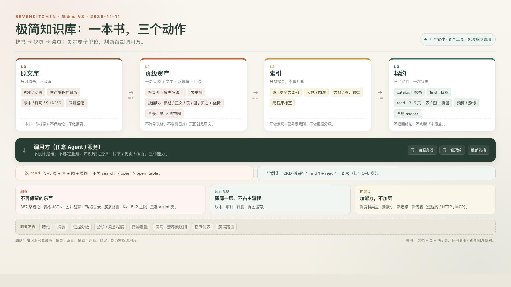

# 知识库 v3：极简图书馆设计与职责边界

**日期**：2026-11-11
**状态**：方向已确认，待实施
**实施计划**：`docs/superpowers/plans/2026-11-11-kb-v3-implementation.md`
**独立评审**：`docs/knowledge-base/2026-11-11-kb-v3-plan-review.md`
**架构图**：`docs/knowledge-base/assets/kb-v3-architecture.png`
**取代**：`2026-11-09-kb-minimal-library-design.md`、`2026-11-09-knowledge-base-agent-service-review.md` 的运行时方案（历史文档保留，只作背景）
**版本说明**：本文件的“v3”指**运行时架构**；`2026-11-10-kb-all-domains-launch.md` 的“v3”指**全库上线批次**，两者不是同一条版本线。

---

## 0. 一页纸结论

知识库只做四件事：**收书、做页、编目、借阅**。

- **收书**：一份原文一份档案，登记版本、许可、校验；
- **做页**：一页 = 整页图 + 文本层 + 版面块 + 目录；
- **编目**：页/块全文索引 + 表题/图注 + 元数据；
- **借阅**：`catalog` / `find` / `read` 三个动作，给页码和原文，不给结论。

明确不做：结论、摘要、证据分级、分诊、药物剂量、疾病—营养素规则、临床词表、疾病路由、Agent 编排、提示词、权限角色。

**本次范围不含任何 Agent 的接入设计。** 只定义知识库对外的最小能力；谁接、怎么接、给谁开，另行决定。

---

## 1. 目标与非目标

### 1.1 目标

1. **Agent 用最少的调用拿到足够证据**：已知文档 1 次 `read`；未知位置 1 次 `find` + 1 次 `read`；
2. **页是原子单位**：一次 `read` 默认拿 3–5 页；带 `tocId`/大预算可按预算读整章，表、图、页图一并返回；
3. **原文可回源**：任何引用都能落到“文档 + 页 + 块/表”，人能打开原页核对；
4. **视觉可用**：表格/图片不再转录成 JSON，模型直接看页图；
5. **架构小**：4 个实体、3 个工具、1 个索引、运行时 0 次模型调用；
6. **快速上线**：2 人 2–3 周，不做旧接口兼容、不做双轨；
7. **可扩展**：加资料类型、索引、渲染、传输都不加层。

### 1.2 非目标

- 不设计任何具体 Agent（配方、原料、健康分析等）；
- 不设计 Agent 权限、角色、配额、提示词；
- 不做结论、摘要、证据分级、分诊、剂量、疾病规则；
- 不做向量检索/embedding/reranker（首版）；
- 不做表格转录、图片裁剪；
- 不做旧表/旧接口兼容；
- 不保证中文查询直接命中英文原文；查询语言由调用方处理（见 §7）。

---

## 2. 职责边界

### 2.1 做与不做

| 知识库做 | 知识库不做 |
|---|---|
| 收原书、登记版本/许可/SHA256 | 写结论、摘要、要点 |
| 页图、文本层、版面块、目录 | 证据分级、冲突取舍、紧急程度 |
| 页/块索引、表题/图注 | 分诊、诊断、药物剂量 |
| 文档/页元数据 | 疾病—营养素规则、临床词表 |
| `catalog` / `find` / `read` | 疾病路由、分期/物种/主题门禁 |
| 引用锚点、预算/游标 | 设计谁來调、怎么编排、提示词 |

### 2.2 三条判定规则

1. **原文里本来就有的**（标题、页码、版面、表题、图注）→ 入库；
2. **人/模型改写、归纳、分级、取舍**→ 一律不入库；
3. **根据查询词猜出来的**（病种、分期、物种、主题）→ 不入库，也不做检索条件。

> 一句话：知识库只回答“哪一页、哪张表、原文是什么”，不回答“这意味着什么、该怎么办”。

---

## 3. 六个硬决策

### 决策 1：387 条结论全部删除

- 不迁移、不建“临床内容服务”、不在知识库里留一张结论表；
- 证据分级、冲突取舍、紧急程度、复核日期随结论一起删除；
- **影响**：健康分析（顾客侧/营养师侧）会失去结论来源。这是“知识库只做原文”的直接结果，知识库不提供替代结论。健康分析怎么办，另行决定。

### 决策 2：页是唯一原子单位

删掉：节、段、表格 JSON、图片裁剪、条目锚点。

只留：

- **书**：一份原文档案；
- **页**：页图 + 文本 + 版面块 + 页码；
- **块**：标题/正文/表/图/脚注 + 坐标；
- **目录**：章 → 页范围。

页同时承载文字、版面、表、图、脚注，是引用、视觉、阅读的共同单位。节和段最多是页上的标签，不是独立实体。

### 决策 3：不做表格转录，也不裁剪图片

- 表/图只存：页码、区域坐标、表题/图注；
- 内容让模型直接看页图；
- 不生成 499 张表的 JSON，不生成 592 张图的裁剪文件；
- 表格检索靠页文本层 + 表题/图注；命中不了就按目录读页，不靠转录。

### 决策 4：只要 3 个工具

| 工具 | 作用 |
|---|---|
| `kb_catalog` | 找书：有哪些文档、版本、页数、目录 |
| `kb_find` | 找页：按词找候选页，返回页码 + 命中块/表题 |
| `kb_read` | 读页：默认 3–5 页，可按预算读整章；带文本、表/图、页图、预算/游标 |

没有 `open_table`、`open_figure`、`open_section`、`resolve`。`read` 一次把整页（含表和图）给你；引用锚点本身就是可解析的。

**调用次数下降来自“一次读多页”，不是来自加工具、加约束、改提示词。**

### 决策 5：不做临床语义

删掉：

- 疾病路由（查询里出现“肾病”就只搜肾病文档）；
- 临床词表（460 行中英对照）；
- 分期/物种/主题推断与门禁；
- CKD 专用加权、核心表白名单；
- “0 命中 = 知识库未覆盖”的话术。

查询用什么语言、查哪个范围，由调用方决定。知识库只做字面检索和页级读取。

### 决策 6：不做 Agent 接入设计，也不做旧接口兼容

- 本次只交付知识库服务 + 3 个通用动作；
- 现有 Agent 的旧知识工具与引用门禁随旧知识库一起移除，避免半新半旧；
- 谁接新知识库、怎么接，另行决定；
- 旧表、旧服务、旧接口、旧脚本直接下线，不做兼容层。

---

## 4. 架构



```
L0 原文库           L1 页级资产              L2 索引                 L3 契约
PDF / 网页    →    整页图 + 文本 +     →    页/块全文索引      →    catalog / find / read
受保护目录         版面块 + 目录            表题 / 图注             预算 / 游标 / anchor
版本/许可/SHA256                            文档/页元数据
                                                                    ↓
                                                          调用方（任意 Agent / 服务）
```

### 4.1 四层

| 层 | 作用 | 回答的问题 | 明确不做 |
|---|---|---|---|
| **L0 原文库** | 收原书，登记版本/许可/校验 | 我们有哪些可信的原书？ | 不改写、不做结论 |
| **L1 页级资产** | 一页 = 图 + 文本 + 版面块 + 目录 | 这一页长什么样？表在哪？ | 不转录表格、不裁剪图片 |
| **L2 索引** | 页/块全文索引 + 表题/图注 | 哪一页可能相关？ | 不做临床标签、不做证据分级 |
| **L3 契约** | `catalog` / `find` / `read` | 把那一页/那几页给我 | 不返回结论、不判断“未覆盖” |

### 4.2 调用方

- 任意 Agent / 服务，同一台服务器优先走进程内 Nest provider；
- 未来要进程隔离，用 localhost HTTP/MCP，**契约不变**；
- 本次不设计“谁可以调、按什么角色调”；只提供能力。

### 4.3 运行规则（薄）

版本、审计、评测、页图缓存。不占主流程，不新增层。

**本次不做权限/鉴权/角色**：知识库是内部只读服务，调用方身份与授权由传输层以后决定；本设计不设计“谁能调”。

---

## 5. 数据模型：4 个实体

| 实体 | 存什么 | 不存什么 |
|---|---|---|
| **书 `kb_source`** | id、collection、标题、出版方、版本、年份、状态、许可、SHA256、归档路径、页数、是否有文本层 | 不改写、不拆章 |
| **页 `kb_page`** | id、书、页码、页图路径/渲染时间、文本、字符数、宽高 | 不做摘要、不做段落切分 |
| **块 `kb_block`** | id、页、类型（标题/正文/表/图/脚注）、bbox、文本/表题/图注、顺序 | 不转录表格内容、不裁剪图片 |
| **目录 `kb_toc`** | id、书、章节标题、层级、起止页、顺序 | 不做临床标签、不做主题分类 |

**索引**是派生结构，不是新实体：页/块文本 + 表题/图注，随时可重建。

### 5.1 ID 与锚点

- 书 ID：沿用现有稳定 ID，如 `sacn5-chapters-SACN5-37`；
- 页 ID：`{sourceId}-p{pageNo:4}`，如 `sacn5-chapters-SACN5-37-p0022`；
- 块 ID：`{pageId}-b{order:4}`，如 `...-p0022-b0003`；
- 引用锚点：
  - 页：`{sourceId}/p{pageNo}`；
  - 块：`{sourceId}/p{pageNo}#b{order}`；
- 锚点是全局的、可持久化的；不使用会话内 K#。

### 5.2 为什么是 4 个

每多一个实体，就多一份同步、校验、漂移和维护成本。上一版 6 张原文表 + 387 条结论 + 499 张表 JSON + 592 张图，复杂度远大于价值。

---

## 6. 契约：3 个动作

### 6.1 通用返回

```text
成功：{ ok: true, data, requestId? }
失败：{ ok: false, error: { code, message } }
```

错误码：`INVALID_ARGUMENT`、`SOURCE_NOT_FOUND`、`PAGE_OUT_OF_RANGE`、`TOC_NOT_FOUND`、`IMAGE_UNAVAILABLE`。

### 6.2 `kb_catalog`

```text
输入：{ collection?: string, documentId?: string }
输出：{
  sources: [{ id, collection, title, publisher?, version?, publishedYear?,
              status?, license?, pageCount, hasTextLayer }],
  toc?: [{ id, title, level, pageFrom, pageTo }]
}
```

用途：知道“库里有什么、这本书的目录是什么”。一次会话调一次即可，可缓存。

### 6.3 `kb_find`

```text
输入：{ query, collections?: string[], documentIds?: string[], limit?: number }
输出：{
  hits: [{ documentId, pageNo, chapter?, blockId?,
           kind: 'page' | 'table' | 'figure', snippet, score, anchor }],
  searched: { documents, pages }
}
```

规则：

- 只返回页码、命中块/表题、短摘要；不返回大段正文；
- 没有命中返回 `hits: []` + `searched`，**不说“知识库未覆盖”**；
- 不做疾病/分期/物种过滤，只接受文档/集合范围；
- `limit` 默认 10，最大 30；
- `documentIds: []` / `collections: []` 表示“范围为空”，返回 0 命中 + `searched` 0，**不退回全库**；
- 空 query → `INVALID_ARGUMENT`；
- query 只放**内容词/短语**（如 `phosphorus`、`"vitamin k"`），不要塞 `CKD/dog/target` 这类背景词或整句；去背景词、翻译由调用方做。这样 `find` 不需要临床词表，也不会把“词没命中”说成“知识没覆盖”。

### 6.4 `kb_read`

```text
输入：{
  documentId,
  pageFrom?, pageTo?, tocId?,
  includeImages?: boolean,
  budgetTokens?: number,
  cursor?: string
}
输出：{
  documentId,
  pages: [{
    pageNo, text, anchor,
    blocks: [{ id, kind, bbox, caption?, anchor }],
    imagePath?: string, imageMime?: 'image/jpeg',
    imageBase64?: string
  }],
  nextCursor?: string,
  version
}
```

规则：

- 默认读 3–5 页；带 `tocId` 或大 `budgetTokens` 时可按预算读整章；按 `budgetTokens` 截断，给游标；
- `budgetTokens` 默认 20,000，最大 200,000；至少返回一页，避免死循环；
- `includeImages` 默认 true：所有 PDF 页都有页图，返回 `imagePath`（只是路径，开销小）；`false` 时省略；
- `imagePath` 是相对 `KB_PAGE_IMAGE_ROOT` 的路径；默认同时返回 `imageBase64`（JPEG base64），调用方可以直接塞进模型的 image content；每次 `read` 最多带 5 张图（约 0.5–0.8 MB），超过的页只给 `imagePath`；`includeImages:false` 时两者都不给；
- 每页/每块带 anchor；
- `blocks` 只给结构（kind/bbox/caption/anchor），**不重复 `page.text`**；正文读 `page.text`，避免 payload 翻倍；
- 不返回结论、不返回摘要、不做“是否覆盖”的判断；
- `pageFrom`/`pageTo` 越界 → `PAGE_OUT_OF_RANGE`；`tocId` 不存在 → `TOC_NOT_FOUND`；
- 同时给 `cursor` 与页码时，以 `cursor` 为准（游标里已带 `endPage`）；`cursor.documentId` 必须与入参一致。

### 6.5 为什么没有 `kb_resolve`

引用锚点本身就是自描述的：

- `{sourceId}/p22` 能定位到页；
- `{sourceId}/p22#b3` 能定位到块；
- 任何调用方都可以用 `kb_read` 打开该页核对。

不需要再调一个工具“解析引用”。如果人类要一个可点击的引用页，那是 Web 层的事，不是 Agent 工具。

---

## 7. 索引与查询

- 首版：PostgreSQL 全文索引（`to_tsvector('simple', text)`）+ `pg_trgm` 兜底；
- 不做向量/embedding/reranker；
- 查询语言：知识库只做字面检索；中文查英文资料，由调用方在调用前翻译。知识库不维护临床词典；
- 索引字段：页文本、块文本、表题/图注；不索引结论、不索引临床标签；
- 过滤条件：`collection` / `documentIds`；没有疾病/分期/物种过滤；
- 排序：词频 + 稀有度 + 页码顺序；不做临床加权。

---

## 8. 页图与数字化

### 8.1 解析

- 用 PyMuPDF（`fitz`）逐页解析：
  - 页文本：`page.get_text("text")`；
  - 版面块：`page.get_text("dict")` 的 blocks/lines；保留 bbox；
  - 表：`page.find_tables()` 的 bbox，记为 `kind=table`；它是线检测，borderless 表可能检测不到——页图仍在，`read` 仍能看表；不为了出块去猜外框；
  - 图：`page.get_images()` + `get_image_rects()`，记为 `kind=figure`；
  - 目录：`doc.get_toc()`；没有就写一条“全文 1..N”。
- 不合并/改写文本；不做 50–800 字切段；不做表格行列转录；
- 非 PDF（TXT/XML/HTML）：读文本，按 ~3,000 字切“伪页”，`pageCount=N`，无页图；避免一个 190 万字的 NRC/TXT 变成单页；
- 扫描件：文本为空，页图仍生成；`find` 可能命中不了，但 `read` 能打开页图。

### 8.2 页图

- **所有 PDF 页都渲染**：110 dpi JPEG，质量 78；纯文字页也有图，避免“表格没检测到就没有图”；
- `read` 默认把页图转成 base64 返回（最多 5 张），模型可直接看；`imagePath` 保留给缓存/HTTP 适配器；
- 批量/断点续渲，不在 `read` 请求里渲染；159 份实测 **479 MB**（2,393 张），按 2–3 GB 预留、磁盘留 ≥6 GB；放 `KB_PAGE_IMAGE_ROOT`，不进 git；
- 生产路径定死：`/var/lib/sevenkitchen/kb/page-layer`、`/var/lib/sevenkitchen/kb/page-images`；渲染/导入用一次性 root job，产物 `chown` 给后端用户；磁盘至少留 2× 预估（≥6 GB），并在 runbook 里做 `df` 检查；
- 存储根：`KB_PAGE_IMAGE_ROOT`（本地/生产各自配置），**不进 git**；
- 页图只给内部调用方；不生成公开 URL；不做公网静态目录；
- **权限边界**：解析/渲染用有源目录读权限的用户（root/受权组）跑，产出目录 `chown` 给后端运行用户；后端只读 DB + 页图，**不直接读** `/opt/sevenkitchen/knowledge-sources`（700/root）。

### 8.3 解析产物

- `docs/knowledge-base/page-layer/<sourceId>.json`：书 + 页 + 块 + 目录；
- 生成物**不进 git**（体积大、可由原文重建）；只提交解析器、导入器和一个小 fixture；
- 导入脚本幂等：按 `sourceId` 删除旧页/块/目录再插入，或按 checksum 跳过。

---

## 9. 调用次数：结构基准与 Agent 实测分开

### 9.1 两个不同的问题

| 指标 | 谁控制 | 本计划是否做 | 说明 |
|---|---|---|---|
| **结构基准**：固定流程的 reference caller 用几次 `find`/`read` 拿到目标页 | 知识库（返回单元/索引/预算） | **做** | 证明接口“一次能给多页”，不证明模型会这样调 |
| **Agent 实测**：真实模型在真实提示词/业务工具下用几次知识库调用 | 调用方 Agent | **不做**（本次不接 Agent） | 必须冻结模型/提示词/业务工具做 A/B；不能用改提示词/加约束刷指标 |

**本计划不宣称“模型调用次数下降”。** 它只保证：接口有能力让一次调用拿到 3–5 页，且不需要 `open_table`/`open_figure`/`open_section` 的多次跳转。真实的模型调用次数，等 Agent 接线后由调用方按下面的协议测。

### 9.2 结构基准（本计划内做）

用固定流程的 reference caller（不是模型）跑固定题集：

- 已知文档/章节：直接 `kb_read` → 1 次；
- 未知位置：`kb_find` → 取 top 1 页 → `kb_read` → 2 次；
- 探索性：最多两次 `kb_read` → ≤3 次；
- `kb_catalog` 是会话 setup，单独记，不计入每题；如果每题都调，另加 1 次。

这个基准只证明“接口能力”，不证明“模型会这样调”。脚本输出必须标注 `reference caller, not model`。

### 9.3 Agent 实测（本计划外，给接线后的调用方）

如果要把“模型调用次数”作为上线指标，必须：

1. 冻结同一个模型、同一套提示词、同一套业务工具；
2. 只换知识库（旧接口 vs v3）；
3. 同一组题，记录：知识库调用次数、每次返回有效页数、首次命中页排名、读了但没被引用的页数、延迟、token；
4. 不许为了降次数改提示词、加“你必须先…”的约束、加专用工具；
5. 只有“同一 Agent、同一提示词、只换知识库”时次数下降，才算架构的功劳。

**本次不接 Agent，所以不做这一步；不要用 reference caller 的数字冒充模型调用次数。**

### 9.4 结构基准目标

| 场景 | 目标 |
|---|---|
| 已知文档/章节 | 1 次 `kb_read` |
| 已知问题、不知道在哪 | 1 次 `kb_find` + 1 次 `kb_read` = 2 次 |
| 探索性问题 | ≤3 次 |
| 单次 `read` | 默认 3–5 页；整章按预算 |

如果结构基准超过 2–3 次，先改单元/索引/返回大小，不许加工具、不许改提示词、不许加约束。

### 9.5 为什么 v3 会降（能力层面）

- 页是单位：默认一次读 3–5 页，不是 2 段；整章可按预算一次读；
- `find` 直接给页码，不需要“搜节 → 开节 → 开表”；
- 页图包含表和图，不需要单独的 `open_table` / `open_figure`；
- 目录可直接定位，已知文档时 1 次 `read` 就够；
- 没有 5 节 × 2 段的硬上限，也没有“翻开下一页”的多次调用。

---

## 10. 可扩展性

| 要加的能力 | 怎么加 | 要不要加层 |
|---|---|---|
| 新资料类型（网页/扫描件） | 新增一个“做页”适配器，输出同样的 page/block | 不加 |
| 新索引（以后要向量） | 在 `find` 后面加一个索引策略，页/块模型不变 | 不加 |
| 新渲染（缩略图/局部放大） | 换渲染器，`read` 契约不变 | 不加 |
| 新传输（进程内/HTTP/MCP） | 同一套 3 个动作，换传输层 | 不加 |
| 新元数据（许可/版本/来源） | 加字段，不动页/块 | 不加 |

**4 个实体、3 个工具、1 个索引、0 次模型调用**——这是长期骨架。扩展点都在“策略”里，不在“层”里。

---

## 11. 迁移与上线

### 11.1 时间表（2 人 2–3 周）

| 周 | 做什么 | 产出 |
|---|---|---|
| **第 1 周** | 建 4 个实体；写“做页”解析器；导入 159 份文档；页图按需渲染 | 每本书都有页/块/目录 |
| **第 2 周** | 建索引；实现 `catalog` / `find` / `read`；anchor、预算、游标；内部冒烟 | 3 个动作可用，引用可回源 |
| **第 3 周** | 页图缓存；结构基准；删除旧表旧接口；写运行手册 | v3 上线，旧架构下线 |

### 11.2 不做兼容

- 不保留旧表、旧服务、旧工具、旧脚本；
- 不做“新旧双读”；
- 旧数据可由原文重建；旧结论直接删除（git 历史保留）。

### 11.3 影响

- **健康分析**：失去 387 条结论来源，分析功能下线/不可用，等待另行决定；
- **现有 Agent**：旧知识工具与引用门禁随旧 KB 移除；新 KB 的 3 个动作本次不接任何 Agent；
- **顾客侧**：不暴露页图/全文；本次不新增对外接口。

### 11.4 基础设施前提

- 生产原文目录 `/opt/sevenkitchen/knowledge-sources` 是 `700`、root 属主；解析/渲染进程需要读权限；
- 解决方式：单独渲染服务、组权限、或受控 sidecar；不把原文复制到站点根目录；
- 页图/解析产物放 `KB_PAGE_IMAGE_ROOT` / `KB_PAGE_LAYER_DIR`，生产用 `/var/lib/sevenkitchen/kb/...`，不进 git、不进 nginx 站点根；
- 渲染/导入是一次性特权 job（root/受权组），后端只读产物；不在请求路径里渲染。

---

## 12. 验收

| 项 | 目标 |
|---|---|
| 结论数据 | **0 条**（代码/审核包/审核包标题均 0；DB 无结论表，旧锚点表已 drop） |
| 运行时模型调用 | **0 次**（入库也不用 LLM） |
| 实体 | **4 个**（书/页/块/目录） |
| 工具 | **3 个**（catalog/find/read） |
| 单次读取 | 默认 2–5 万 token，最高 20 万 |
| 整章阅读 | 16 万 token 的章，1–3 次读完 |
| 表格题 | 从页图取数，引用到页 + 表；表格检测漏了也有页图 |
| 图片型文档 | 当前 1 份无文字层文档，能打开、能读；页图可回源 |
| 结构基准（reference caller） | 已知 1 次 read；未知 2 次；探索 ≤3 次；**不是模型调用次数** |
| 引用 | 100% 可回源到文档 + 页 + 块/表 |
| 延迟 | `find` p95 < 300ms；`read` 读本地页图/文本 p95 < 500ms（不含一次性批量渲染） |

---

## 13. 删除清单

| 删除 | 原因 |
|---|---|
| 387 条结论 + `KnowledgeBaseService` + 结论类型/数据文件 | 二次加工，准确性无法判断 |
| 证据分级、冲突取舍、紧急程度、复核日期 | 随结论一起走 |
| `source_section` / `source_paragraph` | 页是原子单位 |
| `source_table`（表格 JSON） | 不转录，页图是真相 |
| `source_figure`（图片裁剪） | 页图包含图，不需要裁剪 |
| `knowledge_citation_anchor` | 锚点由文档+页+块直接生成 |
| 临床词表（`query-expansion` 的 460 行中英对照）、疾病路由、分期/物种/主题门禁、CKD 加权、核心表白名单 | 知识库不做临床语义 |
| 5 节 × 2 段上限、K#、三套 Agent 壳 | 旧检索形态 |
| 旧原文接口 `/api/v1/knowledge-source` | 不安全、行为不一致 |
| 旧知识库脚本/测试/包脚本 | 随旧表下线 |

**保留**：159 份原文、来源登记、SHA256、生产受保护目录、稳定文档 ID、页码、评测纪律（改成页级/结构基准）。

> 387 条结论的物理副本也要清零：`docs/knowledge-base/review-packet/`（两份审核包含 387 条全文）和 `aaha2014-review.md` 删除；其余历史分析文档只允许出现条目 ID，不允许出现完整结论正文。`knowledge_citation_anchor` 表随旧原文层 drop，drop 前确认没有结论行可查。

> 注：`backend/src/domain/recipe-designer/knowledge-base/tag-vocabulary.ts` 是**员工端健康标签**的受控词表（`staff-dog-health` 显示/校验用），不是知识库检索标签；保留它，但不进入 `kb_find` / `kb_read`，也不作为知识库实体。

---

## 14. 风险与开放问题

| 风险/问题 | 处理 |
|---|---|
| 删除结论导致健康分析不可用 | 明确接受；健康分析另行决定，不在本库恢复结论 |
| 现有 Agent 失去知识工具 | 本次不接 Agent；接线另立任务；旧工具移除避免半新半旧 |
| 页图渲染权限（700/root） | 单独渲染服务/组权限；上线前验证 |
| 扫描件/图片型文档无法 `find` | 页图可 `read`；目录/文件名可定位；不承诺全文检索 |
| 表格内容无法被 `find` 命中 | 页文本层常包含表格文字；命中不了按目录读页；不转录 |
| 中文查询英文原文 | 调用方翻译；知识库不做临床词典 |
| 页图版权/暴露 | 只给内部；不生成公开 URL；审计读取 |
| 大页/大章超预算 | 至少返回一页 + 游标；不无限循环 |
| 解析质量（双栏、跨页表） | 页图保真；块坐标只做导航，不作为内容真值 |

---

## 附录 A：CKD 磷目标的目标调用流程

```text
1. kb_catalog({ documentId: 'sacn5-chapters-SACN5-37' })
   → 目录：第 37 章 p17–33；表 37-9 在 p17
2. kb_read({ documentId, pageFrom: 17, pageTo: 21, includeImages: true, budgetTokens: 30000 })
   → 5 页文本 + 表/图块 + 页图；锚点 p17..p21
3. 回答引用：{sourceId}/p20、{sourceId}/p17#b-table-37-9
```

已知文档时 1 次 `read`；不知道页码时 1 次 `find` + 1 次 `read`。

## 附录 B：与旧文档的关系

- `2026-11-09-kb-minimal-library-design.md`：v1.1 的运行时方案（节/段/表格 JSON/K#），已被本文件取代；
- `2026-11-09-knowledge-base-agent-service-review.md`：对旧方案的评审，保留作背景；
- `2026-11-02-ai-readiness-audit.md`：旧资产盘点，保留作背景；
- 本文件是**运行时知识库的唯一设计真源**；实施以本文件为准。

## 附录 C：实施偏差（2026-11-12 Task 11 实测）

- **页数**：`kb_page` 实际 **4,183**（128 份 PDF 2,393 页 + 31 份非 PDF 1,790 个伪页），
  `kb_block` 48,376、`kb_toc` 604、`kb_source` 159。早期说的 27,000+ 是旧原文层的**段落**数，不是页数。
- **页图体积**：2,393 张 / **479 MB**（110 dpi、JPEG q78），低于 §8.2 的 2–3 GB 预估；
  生产磁盘仍按 ≥6 GB 留余量。
- **图片型文档**：实际只有 1 份无文字层文档（`wsava-nutrition-Muscle-Condition-Score-Cat`），
  §12“3–4 篇”是旧盘点，不是验收下限。
- **`find` 排序**：SACN5-37 的 `phosphorus` 第一命中是 p24（推荐量表词频最高），
  章节首页 p17 排第 15；排序按设计 §7 的词频/罕见度，不按章节顺序。冒烟改为验证
  “前 5 条命中覆盖 17–22 节”，随后仍 `read p17–21`。
- **本地页图默认根**：相对 backend cwd 的 `../docs/knowledge-base/page-images`
  （冒烟/测试都在 `backend/` 下跑）；生产必须显式设 `KB_PAGE_IMAGE_ROOT`。
