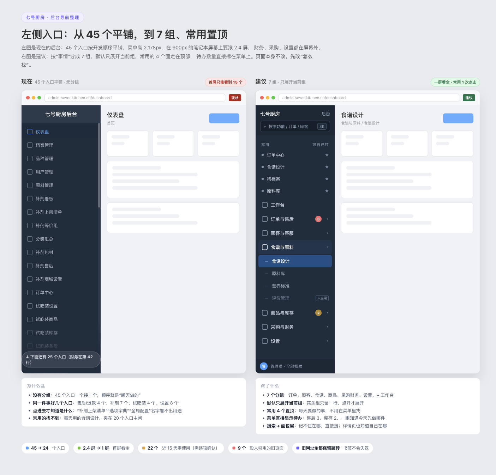
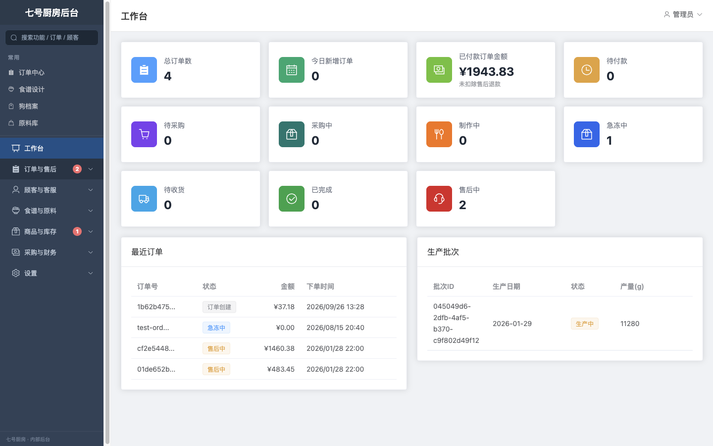

# 后台左侧导航排查报告与优化方案

- 日期：2026-10-30
- 范围：`admin-web` 左侧菜单、菜单背后的页面与路由
- 结论一句话：**不是功能太多，是"没有分组 + 合并后旧入口没删 + 名字看不出用途"。**
  建议从 45 个平铺入口，收敛为 **7 个一级区块 / 24 个入口**，先改"怎么找"，再合并页面。



---

## 一、先看结论

1. **现在有多少入口**：侧边栏 38 个一级项（其中 3 个可展开），展开后 **48 行 / 45 个可点页面**。
2. **有多长**：菜单实际高度 **2,178px**。在 900px 高的笔记本屏幕上要滚 **2.4 屏**，首屏只能看到约 **15 个**；
   财务在最后一个一级项，具体页面排在第 42–45 行，采购、设置都在屏幕外。
3. **实际用了多少**：近 15 天（10/16–10/30）后台接口请求共 53,161 次，
   其中 **食谱设计相关 48,771 次，占 92%**；**22 个入口的专属接口一次请求都没有**，另有 11 个不到 20 次。
4. **重复有多少**：售后/退款 **4 个入口**（另有一个已下线的旧页）、补剂 **7 个**、试吃装 **4 个**、设置 **8 个**、订单 **3 个**（其中 2 个不在菜单）。
5. **垃圾有多少**：**9 个文件、约 5,200 行**页面代码已经没有任何入口引用；
   另有 7 个旧地址只做跳转，还挂在路由里。
6. **建议**：7 个一级区块、24 个入口、默认只展开当前组、常用置顶、菜单上直接显示待办数、按角色显示。
7. **怎么做**：分三步。**第一步只动导航，不动页面，1–2 天，风险最低**；先看效果，再决定合并和删除。

---

## 二、这次是怎么排查的

不是只看代码"觉得乱"，用了三份证据交叉核对：

| 证据 | 怎么取的 | 用来看什么 |
|---|---|---|
| 菜单与路由 | 逐条读 `MainLayout.vue` 的菜单、`router/index.ts` 的 80+ 条路由 | 有多少入口、哪些是死链、哪些页面没人引用 |
| 页面引用关系 | 扫全部 `.vue` / `.ts` 的 import，找出"没有任何文件引用"的页面 | 哪些是可以直接删的死代码 |
| 真实使用 | 生产服务器 nginx 访问日志，10/16–10/30 共 15 天，只筛后台浏览器（排除小程序、开发者工具） | 哪些入口真的有人用、哪些 15 天零请求 |

**口径说明（重要）**：

- 日志记的是"接口请求次数"，不是"页面打开次数"。一个页面打开一次可能发 3–5 个请求，
  所以数字只能横向比较"有没有人用"，不能当成"点了几次"。
- 15 天不长。**"0 请求"只能证明"这 15 天没人用"，不能直接证明"永远不需要"**。
  所以下面把"没上线"和"不需要"分开看，删除建议也分了三档。
- 后台使用高度集中：近 15 天绝大部分请求来自同一台电脑。也就是说，
  **这是一份"老板/核心同事实际怎么用"的记录，不是"所有员工"的记录。**

---

## 三、现状盘点

### 3.1 数量与长度

| 指标 | 现在 |
|---|---|
| 一级菜单项 | 38 个（35 个单项 + 3 个可展开分组） |
| 展开后的可点入口 | 45 个 |
| 菜单总高度 | 2,178px |
| 900px 屏幕首屏可见 | 约 15 个 |
| 需要滚动才能看到 | 约 30 个（财务页面在第 42–45 行） |
| 一级分组 | 只有 3 个（营养标准、采购管理、财务中心），其余全平铺 |
| 菜单搜索 | 无 |
| 常用/收藏 | 无 |
| 按角色显示 | 无，所有登录者看到同一份 45 个入口 |
| 面包屑 | 无，顶部只有当前页标题 |
| 详情页高亮 | 无（`/dogs/:id`、`/orders/:id` 等不在菜单里，进入后左侧没有任何高亮） |

### 3.2 45 个入口全表（按现在的顺序）

> "近 15 天"= 该页面专属接口的请求次数；0 = 一次都没有。
> "少量/共用"表示接口与别的页面共用，无法单独归因。

#### 概览与档案

| # | 入口 | 实际做什么 | 近 15 天 | 判断 |
|---|---|---|---|---|
| 1 | 仪表盘 | 订单统计卡 + 最近订单 + 生产批次 | 26 | 保留，改造成"工作台" |
| 2 | 档案管理 | 狗档案列表/详情/健康档案 | 341 | 保留 |
| 3 | 品种管理 | 系统品种、用户自定义品种 | 28 | **并入狗档案**（一个 tab） |
| 4 | 用户管理 | 顾客账号与资料 | 4 | 保留，改名"顾客" |

#### 原料与营养

| # | 入口 | 实际做什么 | 近 15 天 | 判断 |
|---|---|---|---|---|
| 5 | 原料管理 | 原料库 + 营养治理 + 标签（已经是 tab） | 738 | 保留，作为"原料库" |
| 6 | 营养标准 · FEDIAF 2025 犬标准 | 标准值只读 + 审核标记 | 0 | **三合一** |
| 7 | 营养标准 · 原料计算就绪度 | 原料营养档案完整度检查 | 0 | **三合一** |
| 8 | 营养标准 · FEDIAF 目标预览 | 按生命阶段/MER 看目标值 | 0 | **三合一** |
| 9 | 搜索治理 | 搜索别名、查询洞察、Agent 建议审批 | 0 | 隐藏/移到设置（未上线） |
| 10 | AI / Agent 配置 | 各用途的模型、提示词、生图配置 | 少量（共用） | **移到设置** |

#### 食谱

| # | 入口 | 实际做什么 | 近 15 天 | 判断 |
|---|---|---|---|---|
| 11 | 食谱列表 & 设计 | 食谱设计器（核心工作区） | **48,771** | **保留，放常用第一位** |
| 12 | 评价管理 | 食谱详情页的评价维护 | 0 | 隐藏（功能未上线） |
| 13 | 食谱定制设置 | 定制费、交期、每日接单上限 | 40 | **移到设置·成本与定价** |

#### 订单与售后

| # | 入口 | 实际做什么 | 近 15 天 | 判断 |
|---|---|---|---|---|
| 14 | 订单中心 | 鲜食/定制/补剂三类订单统一列表 | 146 | 保留 |
| — | （补剂订单） | 补剂订单列表，**不在菜单里**，只能从补剂看板/订单中心跳 | 2 | **并入订单中心**，删独立路由 |
| 15 | 退款管理 | 微信退款记录与核对 | 0 | **并入"售后与退款"** |
| 16 | 退款申请 | 定制订单退款审批 | 0 | **并入"售后与退款"** |
| 17 | 售后待办 | 定制订单售后工单 | 14 | **并入"售后与退款"** |
| 18 | 补剂售后 | 补剂退款/补发/驳回 | 8 | **并入"售后与退款"** |
| 19 | 排期日历 | 定制订单排期、按星期休息规则 | 5 | 保留（订单组） |

> 旧"售后工单"页（`/aftersale`）已经改成跳订单中心，但 682 行页面代码还在，属于死代码。

#### 补剂商城

| # | 入口 | 实际做什么 | 近 15 天 | 判断 |
|---|---|---|---|---|
| 20 | 补剂看板 | 今日新单/已付款/待排期等经营指标 | 5 | **并入"补剂"**（看板 tab） |
| 21 | 补剂上架清单 | 补剂上架档案完整度、一键上架 | 44 | **并入"补剂"**（商品 tab） |
| 22 | 补剂等价组 | 可互相替代的补剂分组与审核 | 164 | **并入"补剂"**（商品 tab） |
| 23 | 分装汇总 | 当天单数/袋数/包材/缺料 | 7 | **并入"补剂"**（分装 tab） |
| 24 | 补剂包材 | 袋/标签/干燥剂规则 | 34 | **并入"补剂"**（分装 tab） |
| 25 | 补剂商城设置 | 加价倍率、分装服务费、运费 | 24 | **移到设置·成本与定价** |

#### 试吃装

| # | 入口 | 实际做什么 | 近 15 天 | 判断 |
|---|---|---|---|---|
| 26 | 试吃装设置 | 试吃倍率、合并成本规则 | 0 | **四合一**（含设置 tab） |
| 27 | 试吃装商品 | 套餐组成、上下架 | 0 | **四合一** |
| 28 | 试吃装库存 | 成品批次、出入库、过期下账 | 0 | **四合一** |
| 29 | 试吃装备货 | 无订单备货、采购清单、入库 | 0 | **四合一** |

> 试吃装在顾客端是活的（近 15 天小程序访问 425 次），只是后台这 15 天没人打开。
> **不能因为后台 0 使用就删功能**，应该合并入口、降低存在感。

#### 库存与生产

| # | 入口 | 实际做什么 | 近 15 天 | 判断 |
|---|---|---|---|---|
| 30 | 库存管理 | 原料库存总览、流水、盘点、安全库存 | 18 | 保留（商品与库存组） |
| 31 | 生产管理 | 生产批次列表、创建批次、批次详情 | 26（含首页） | 合并进"商品与库存"组；页面偏旧，后续并成"库存/生产"一个 tab |

#### 采购与财务

| # | 入口 | 实际做什么 | 近 15 天 | 判断 |
|---|---|---|---|---|
| 32 | 采购单管理 | 按订单生成采购单、执行、记录 | 0 | **二合一"采购"** |
| 33 | 采购历史 | 历史采购统计 | 0 | **二合一"采购"** |
| 34 | 报销管理 | 报销单、审核、付款凭证 | 0 | 保留（采购与财务组） |
| 35 | 财务总览 | 收款、付款、结余 | 0 | **四合一"财务"** |
| 36 | 费用与待支付 | 房租水电工资等费用单 | 0 | **四合一"财务"** |
| 37 | 费用分析 | 按类别看费用变化 | 0 | **四合一"财务"** |
| 38 | 经营贡献分析 | 按订单/食谱看贡献 | 0 | **四合一"财务"** |

> 采购/财务这 15 天没有页面请求（只有 14 次报销单图片加载，来自员工端）。
> 但这类是"月底才用一次"的功能，**不能按 15 天判死刑**，建议保留、下沉到组里。

#### 设置与客服

| # | 入口 | 实际做什么 | 近 15 天 | 判断 |
|---|---|---|---|---|
| 39 | 全局配置 | 人工时薪、利润率、间接成本 | 2 | **并入设置·成本与定价** |
| 40 | 支付配置 | 微信支付参数、回调地址 | ≈1 | **并入设置·支付与客服** |
| 41 | 客服配置 | 微信客服/企微接待参数 | ≈1 | **并入设置·支付与客服** |
| 42 | 客服会话 | 顾客咨询记录 | 0 | 保留在"顾客与客服"组（未启用则隐藏） |
| 43 | 选项字典 | 下拉选项、状态中文、色调 | 0 | **移到设置** |
| 44 | 狗档案转化分析 | 建档漏斗、编辑、风险信号趋势 | 0 | 保留在"顾客与客服"组 |
| 45 | 体重管理计划 | 顾客增减重计划与热量调整记录 | 0 | 保留在"顾客与客服"组；若产品未上线则隐藏 |

> 支付配置与客服配置共用同一组日志，合计 2 次，上表各记 ≈1。

### 3.3 使用热力：12 个入口干了几乎所有的活

| 热度 | 入口数 | 是哪些 |
|---|---|---|
| 高（>20 次） | 12 | 食谱设计、原料管理、档案管理、订单中心、补剂等价组、补剂上架、补剂包材、定制设置、品种、仪表盘、生产、补剂设置 |
| 低（1–20 次） | 11 | 用户、补剂看板、分装汇总、补剂售后、排期、售后待办、库存、全局、支付、客服配置、AI |
| **零（0 次）** | **22** | 试吃装 ×4、营养标准 ×3、评价、退款管理、退款申请、选项字典、转化分析、体重、客服会话、采购 ×2、报销、财务 ×4 |

再补一个数字：**食谱设计一个页面占全部后台接口调用的 92%**；
即使把 AI 会话的轮询（40,886 次）全部剔除，仍占 64%。这说明：
**后台真正的日常是"设计食谱 + 查档案 + 看订单"，其余大多是低频管理动作。**

---

## 四、八个问题（都能对上具体证据）

### 问题 1：太长，重要的东西在屏幕外

- 2,178px 的菜单塞进 900px 的窗口，首屏只看到 15 个。
- 财务是最后一个一级项，具体页面排在第 42–45 行；采购、设置、客服都在下面。
- 侧边栏虽然能滚，但 Mac 上滚动条默认隐藏，**看不出下面还有内容**；滚下去以后又看不到上面的分组。
- 结果：**越少用的功能越难找，越常用的功能也被埋在中间。**

### 问题 2：没有分组，顺序就是"开发顺序"

- 45 个入口平铺，只有营养标准、采购、财务 3 个分组。
- 顺序明显是"哪天做完就加在最后"：补剂 7 个挨着、试吃装 4 个挨着、设置类散落在第 10/13/25/26/39/40/41/43 位。
- 没有"订单/顾客/商品/钱/设置"这种**按事情分**的结构，新同事只能一个个点开试。

### 问题 3：同一件事，好几个入口

| 一件事 | 现在有几个入口 | 具体 |
|---|---|---|
| 售后/退款 | **4 个**（另有 1 个死页） | 退款管理、退款申请、售后待办、补剂售后；旧"售后工单"已下线但代码还在 |
| 订单 | **3 个** | 订单中心、补剂订单（不在菜单）、订单管理（旧地址跳转） |
| 补剂 | **7 个** | 看板、上架清单、等价组、分装汇总、包材、售后、商城设置 |
| 试吃装 | **4 个** | 设置、商品、库存、备货 |
| 设置 | **8 个** | 全局、支付、客服、定制、补剂、试吃、选项字典、AI |
| 营养标准 | **3 个** | FEDIAF、就绪度、目标预览 |

这不是"功能多"，是**同一件事被拆成了多个页面，又没有收在一个入口下**。
最典型的是售后：处理一张退款单，要先想"这是鲜食、定制还是补剂"，再去四个不同的页面找。

### 问题 4：名字看不出用途

- **补剂上架清单**：其实是"补剂商品档案完整度"，不是清单。
- **选项字典**：其实是"下拉选项和状态文案"，没人知道"字典"是什么。
- **全局配置**：其实是"成本与定价参数"，和"食谱定制设置""补剂商城设置"是同一类东西。
- **AI / Agent 配置**：名字带斜杠和英文，且和"营养治理里的 Agent 设置"重复。
- **分装汇总 / 补剂包材**：一个看量、一个维护规则，却和"库存"分在三处。
- **档案管理 / 用户管理 / 品种管理**：三个"管理"，分不清哪个是狗、哪个是人。

### 问题 5：入口和页面对不上（点了才知道在哪）

- **补剂看板**上有个"补剂订单"按钮，点进去是 `/supplement-shop/orders`，
  这个地址**不在左侧菜单里**，进去后左侧没有任何一项高亮，用户会以为"跳出去了"。
- **订单详情** `/orders/:id`、**档案详情** `/dogs/:id`、**配方编辑** `/recipe-designer/...`、
  **代客下单** `/custom-recipes/assisted-order` 都是"没有菜单归属"的页面，进入后菜单全灰。
- 顶部只有"当前页标题"，**没有面包屑**，从订单中心点进详情后，不知道自己在哪一层。
- 首页"售后中"卡片跳到的是**订单列表的售后筛选**，不是真正的售后工作台
  （定制售后在 `/custom-recipes/aftersales`，补剂售后在 `/supplement-shop/aftersales`）。
  卡片叫"售后中"，点进去却不是"要处理的售后"，这是一处明确的误导。

### 问题 6：不区分角色，所有人都看到 45 个

- 菜单是写死的一份，**没有按登录角色过滤**。
- 客服/员工登录后，同样能看到财务中心、采购管理、全局配置、支付配置。
- 前端只在按钮上做了"需要管理员"的提示，**菜单层面没有拦**。
- 顺带发现（不在本次导航范围，但建议同批修）：
  后端 `admin-finance`、`admin-purchasing` 两个控制器目前**只校验"登录"，没有校验"管理员"**
  （`AuthGuard` 有，`AdminGuard` 没挂）。也就是说，菜单藏起来只是体验，**真正的边界要在后端补**。
  这一条建议让后端同事单独确认，不要只靠前端隐藏。

### 问题 7：死页面和旧地址混在路由里

- **9 个文件、约 5,200 行**页面代码已经没有任何入口引用：
  - 旧"售后工单"页（682 行）
  - 旧"鲜食订单列表"（1,090 行）
  - 旧"食谱列表"两套（114 + 929 行）
  - 旧"原料标签"页（297 行）
  - 旧"营养治理"页（1,037 行）+ 只被它引用的抽屉（313 行）
  - 旧"定制订单列表"（679 行，测试还在引用它做源码断言）
  - 脚手架 `HelloWorld`（42 行）
- **7 个旧地址**只做跳转：`/recipes`、`/orders`、`/aftersale`、`/custom-recipes`、
  `/nutrition-governance`、`/ingredient-tags`、`/ingredients/ai-create`。
  跳转本身要保留（书签不能失效），但**页面代码可以删**。

### 问题 8：首页不是"今天要做什么"

- 仪表盘是 9 个订单统计卡 + 最近订单 + 生产批次，**没有一个"待办"清单**。
- 老板打开后台，最想知道的是"今天有几单要处理、几单要发货、几个售后要回"，
  现在要自己去订单中心筛。
- 而"待办数"其实已经有了：员工端工作台已经有 `待采购/生产/订单/补剂/报销/库存` 的角标数据，
  **后台可以直接复用，把菜单变成"待办入口"**。

---

## 五、建议的新导航

### 5.1 设计原则

1. **按"事情"分组，不按"开发批次"分组**：订单、顾客、食谱、商品、钱、设置。
2. **一级区块控制在 7 个以内**：人一次能记住的组就这么多。
3. **默认只展开当前组**：其他组只留一行，需要用再点开。
4. **常用的固定在最上面**：不靠"记住它在第几个"。
5. **一个入口只做一件事**：售后就一个入口，里面再分鲜食/定制/补剂。
6. **菜单能回答"今天先做哪件"**：待办数字直接标在组上。
7. **旧地址全部保留跳转**：书签、群里的链接不失效。

### 5.2 新结构（7 个一级区块 / 24 个入口）

```
工作台                          ← 原仪表盘，改成"待办 + 今日数据"

订单与售后  [待办角标]
  ├ 订单中心                    ← 鲜食 / 定制 / 补剂（补剂订单并进来）
  ├ 售后与退款                  ← 售后待办 + 退款申请 + 退款记录 + 补剂售后
  └ 排期日历

顾客与客服
  ├ 顾客                        ← 原用户管理
  ├ 狗档案                      ← 原档案管理 + 品种管理（tab）
  ├ 体重管理计划
  ├ 转化分析                    ← 原狗档案转化分析
  └ 客服会话

食谱与原料
  ├ 食谱设计                    ← 原食谱列表 & 设计
  ├ 原料库                      ← 原原料管理（已含营养治理/标签 tab）
  ├ 营养标准                    ← FEDIAF + 就绪度 + 目标预览
  └ 评价管理                    ← 未上线，先灰显/隐藏

商品与库存  [待办角标]
  ├ 补剂                        ← 看板 + 上架清单 + 等价组 + 分装汇总 + 包材
  ├ 试吃装                      ← 商品 + 库存 + 备货（设置并入"设置·成本与定价"）
  ├ 库存
  └ 生产

采购与财务
  ├ 采购                        ← 采购单管理 + 采购历史
  ├ 报销
  └ 财务                        ← 总览 + 费用与待支付 + 费用分析 + 贡献分析

设置（仅管理员）
  ├ 成本与定价                  ← 全局配置 + 定制设置 + 补剂设置 + 试吃设置
  ├ 支付与客服                  ← 支付配置 + 客服配置
  ├ 选项与文案
  └ AI 配置
```

### 5.3 合并清单（45 → 24）

| 新入口 | 由哪些旧入口合并 | 合并方式 | 数量变化 |
|---|---|---|---|
| 订单中心 | 订单中心 + 补剂订单 + 旧订单管理 | 类型筛选已有，补剂订单并入 | 3 → 1 |
| 售后与退款 | 退款管理 + 退款申请 + 售后待办 + 补剂售后（+ 旧售后工单死页） | 顶部 tab：售后工单 / 退款审批 / 退款记录 / 补剂售后 | 4 → 1 |
| 营养标准 | FEDIAF + 就绪度 + 目标预览 | tab | 3 → 1 |
| 补剂 | 看板 + 上架 + 等价组 + 分装汇总 + 包材 | 页内二级 tab：看板 / 商品 / 分装 | 5 → 1 |
| 试吃装 | 商品 + 库存 + 备货 | tab；设置并入"设置·成本与定价" | 3 → 1 |
| 采购 | 采购单 + 采购历史 | tab | 2 → 1 |
| 财务 | 总览 + 费用与待支付 + 费用分析 + 贡献分析 | tab | 4 → 1 |
| 成本与定价 | 全局 + 定制 + 补剂 + 试吃设置 | 左侧子导航/分区表单 | 4 → 1 |
| 支付与客服 | 支付配置 + 客服配置 | tab | 2 → 1 |
| 狗档案 | 档案管理 + 品种管理 | 页内 tab | 2 → 1 |

> 补剂商城设置、补剂售后、试吃装设置这三项是"跨组"移动：
> 设置类进"设置"，售后类进"售后与退款"，不算丢失。
>
> 另外，**搜索治理**（15 天 0 使用、内部工具）不在这 24 个里，建议先下线/移出菜单；
> 如果以后要用，再放回"设置"。

### 5.4 角色菜单

| 区块 | 管理员 | 员工（客服/营养师） |
|---|---|---|
| 工作台 | ✓ | ✓ |
| 订单与售后 | ✓ | ✓ |
| 顾客与客服 | ✓ | ✓ |
| 食谱与原料 | ✓ | ✓ |
| 商品与库存 | ✓ | ✓ |
| 采购与财务 | ✓（含财务） | 只显示采购、报销 |
| 设置 | ✓ | ✗ |

这样员工看到的是 5 个区块，管理员看到 7 个。
**前端隐藏只是体验，后端仍要按角色校验**（尤其财务、采购，见问题 6）。

---

## 六、UI 与交互细节（用户视角）

### 6.1 侧边栏：从"长列表"变成"手风琴"

- **默认只展开当前页所在的分组**。比如在"食谱设计"，只展开"食谱与原料"。
- 点其他分组时，**当前组自动收起**（手风琴），避免又变成一根长条。
- 记住上次的展开状态：刷新后不跳回默认。
- 分组标题用 12px 灰色小字 + 上下留白，子项 13–14px；
  当前项用**左侧 3px 蓝色竖条 + 深色底**，不只靠颜色变化。
- 侧边栏宽度 200px → **220–240px**（中文名字更长），支持折叠成 **64px 图标栏**，
  给右侧表格更多空间。
- 如果保留滚动：**分组标题吸顶**，进入页面时把当前项 `scrollIntoView`，不要让人自己找。

### 6.2 顶部：搜索 + 最近访问

- 侧边栏顶部固定一个搜索框，占位文案"搜索功能、订单、顾客…"，支持 `Ctrl/⌘ + K` 唤起。
- 搜索范围包括：页面名、旧名（"档案管理"能搜到"狗档案"）、页面里的关键词（"退款""分装""FEDIAF"）。
- 搜索结果分两组：**页面** 和 **常用操作**（如"新建狗档案""代客下单"）。
- 搜索框下面放"最近访问 5 个"，临时离开再回来不用重找。

### 6.3 常用：4 个钉在顶部

- 默认钉：**订单中心、食谱设计、狗档案、原料库**。
- 支持手动置顶/取消（右键或拖拽），存在本地，不跨人。
- 常用区是"每天要做的事"，分组是"偶尔要做的事"，两者分开，不要混。

### 6.4 待办角标：把菜单变成"今天做什么"

- 只显示"需要你处理"的数量，不显示总数：
  - 订单与售后：待处理售后 + 待审核退款
  - 商品与库存：待采购 + 待发货/待分装 + 库存预警
  - 采购与财务：待审核报销
- 超过 99 显示 `99+`；为 0 不显示。
- 数据来源现成：员工端工作台的角标接口已经有 `待采购/生产/订单/补剂/报销/库存`，
  后台复用即可，不用新造一套。
- 这样老板打开后台，**不用先点进页面，就知道今天有几件事**。

### 6.5 面包屑与高亮

- 顶部标题左边加面包屑：`食谱与原料 / 食谱设计`；详情页：`订单与售后 / 订单中心 / 订单详情`。
- 进入详情页、抽屉、编辑器时，**父级菜单保持高亮**（现在全灰）。
- 浏览器后退时，高亮和展开状态跟着回来。

### 6.6 命名规范

| 现在 | 建议 | 理由 |
|---|---|---|
| 档案管理 | 狗档案 | 和"顾客"区分开 |
| 用户管理 | 顾客 | 后台语境里"用户"太泛 |
| 补剂上架清单 | 补剂 · 商品 | 它做的是商品档案，不是清单 |
| 补剂商城设置 | 设置 · 成本与定价 | 和其他定价配置放一起 |
| 全局配置 | 设置 · 成本与定价 | 名字说清"配的是什么" |
| 选项字典 | 设置 · 选项与文案 | 说人话 |
| AI / Agent 配置 | 设置 · AI 配置 | 去掉斜杠和英文 |
| 狗档案转化分析 | 转化分析 | 已经在"顾客"组里，不用重复"狗档案" |
| 分装汇总 / 补剂包材 | 补剂 · 分装 | 一个看量、一个维护规则，同一件事 |
| 食谱列表 & 设计 | 食谱设计 | "列表"已经并进设计器了 |

统一规则：**动词/名词不超过 6 个字；同一层级不出现两个相同词；名字里能看出"给谁用、做什么"。**

### 6.7 未上线/未启用：不要用"空页面"占位置

- 评价管理、搜索治理、客服会话、体重管理计划这些 15 天 0 使用的，
  如果是"功能还没上线"，**保留入口但灰显**（老板 2026-10-30 口径），
  点不进去并说明"未启用、什么时候能用"，不要给一个空表格，也不要把入口直接删掉。
- 反过来，**试吃装、补剂这种"顾客端已经在用、后台只是这阵子没打开"的，不能隐藏**，
  要合并入口、降低层级，但不能让人找不到。

### 6.8 视觉与可达性

- 菜单文字最小 13px（现在 12.5px 偏小），行高 40–44px，点击区域够大。
- 深色底上的灰色文字对比度要够（当前 `#bfcbd9` on `#304156` 尚可，但子项更浅的灰色要避免）。
- 键盘：`Tab` 能走到每个菜单项，`Enter` 进入，`Esc` 关搜索；焦点有可见描边。
- 1280px 宽的笔记本上不出现横向滚动；侧边栏折叠后，表格列不被挤压。

### 6.9 三个真实场景（改完之后）

- **客服早上上班**：打开"工作台"，先看到"售后 3、待发货 5"；点"售后与退款"，
  在同一个页面按"鲜食/定制/补剂"处理，不用再记四个页面在哪。
- **老板月底看钱**：进"采购与财务 → 财务"，四个 tab（总览/费用/分析/贡献）一次看完；
  不用先滚两屏找"财务中心"。
- **营养师做食谱**：常用区第一个就是"食谱设计"，一次点击进入；
  要查原料营养，点"原料库"，不用回菜单再找。

---

## 七、逐项处理清单

### A. 直接删除（死代码，不影响任何入口）

| 文件/页面 | 行数 | 为什么可以删 |
|---|---|---|
| 旧"售后工单"页 | 682 | 路由已改成跳订单中心，没有任何入口引用 |
| 旧"鲜食订单列表" | 1,090 | 订单已统一到订单中心 |
| 旧"食谱列表"两套 | 114 + 929 | 食谱已合并到设计器 |
| 旧"原料标签"页 | 297 | 已并进原料管理的 tab |
| 旧"营养治理"页 + 抽屉 | 1,037 + 313 | 已并进原料管理的 tab；子组件仍被原料页使用，只删页面和只被它引用的抽屉 |
| 旧"定制订单列表" | 679 | 已并进订单中心；**先改 4 个引用它的源码断言测试，再删** |
| `HelloWorld` 脚手架 | 42 | 模板残留 |

合计约 **5,200 行**。删之前跑一次构建和测试；删之后旧地址仍可跳转。

### B. 删入口、保留页面 30 天（观察期）

| 动作 | 入口 |
|---|---|
| 并入狗档案 | 品种管理 |
| 三合一 | 营养标准 ×3 |
| 三合一（设置归入"成本与定价"） | 试吃装商品 / 库存 / 备货 |
| 五合一 | 补剂看板/上架/等价组/分装/包材 |
| 四合一 | 财务 ×4 |
| 二合一 | 采购单 + 采购历史 |
| 四合一 | 全局/定制/补剂/试吃设置 |
| 二合一 | 支付配置 + 客服配置 |
| 删独立路由（页面组件保留给订单中心） | 补剂订单 |

**为什么保留页面**：入口没了，但页面还在，旧链接还能打开；
30 天内如果没人反馈"找不到"，再删代码。这样不会出现"删完才发现有人用"。

### C. 建议下线（需要老板拍板）

| 入口 | 证据 | 建议 |
|---|---|---|
| 评价管理 | 后台 0 请求；评价接口 15 天 0 请求 | 若"食谱评价"没上线，先隐藏，别占一级 |
| 搜索治理 | 后台 0 请求；5 月上线后只有 1 次提交 | 工具型功能，移到设置或隐藏 |
| 客服会话 | 后台 0 请求；顾客端只有 10 次咨询上下文请求 | 等客服真正启用再放出 |
| 体重管理计划 | 后台 0；顾客端也没有访问 | 产品没上线就隐藏；上线再放"顾客"组 |
| 转化分析 | 后台 0，但顾客端有 127 次埋点 | 数据在积累，**保留**，放"顾客"组，不占一级 |

### D. 一定保留（高频/核心）

食谱设计、原料库、狗档案、订单中心、补剂上架/等价组/包材、食谱定制设置、
库存管理、生产管理、排期日历、售后待办、补剂售后。

---

## 八、分三步落地

### 第一步（P0）：只改导航，不改页面 —— 1–2 天，风险最低

做什么：

1. 把菜单从"写死在页面里"改成**一份可配置清单**：分组、排序、角色、是否显示。
2. 侧边栏改成**手风琴分组**，默认只展开当前组。
3. 顶部加**搜索**（Ctrl/⌘+K）和**最近访问**。
4. 加**常用置顶**（默认 4 个）。
5. 按**角色过滤**（管理员/员工两套）。
6. 加**面包屑**，详情页/抽屉保持父级高亮。
7. 按第 6.6 节**统一改名**。
8. 菜单角标先接现成的员工端待办数（只读）。

不做什么：不改任何页面内容、不改 URL、不改数据、不动业务逻辑。
**旧地址全部保留跳转**，书签不受影响。

风险与回滚：只动布局文件和一个菜单配置文件，出问题改回来即可。

### 第二步（P1）：合并入口 —— 4–6 天

按"先高频、后低频"的顺序，每合并一个上线一个：

1. **售后与退款**（4 → 1）：最痛，优先做。
2. **财务**（4 → 1）、**采购**（2 → 1）：月底才用，但一次找四个页面很烦。
3. **补剂**（5 → 1）、**试吃装**（3 → 1）。
4. **营养标准**（3 → 1）、**设置**（8 → 4）、**狗档案 + 品种**（2 → 1）。
5. **订单中心**吸收补剂订单。

做法：新建一个"容器页"，顶部 tab，里面直接复用现有页面组件；
旧地址带 `?tab=` 重定向到新页，保证旧链接能落到正确的 tab。
**不改数据模型、不改业务规则**，只改"入口怎么摆"。

### 第三步（P2）：清理 —— 1 天

1. 删 A 类死代码约 5,200 行。
2. 删 `/supplement-shop/orders` 独立路由（保留组件给订单中心）。
3. 更新引用旧页面的 4 个源码断言测试。
4. 旧地址 redirect 保留 30 天，之后按访问日志决定是否移除。

### 可选（P3）：工作台改版 —— 2 天

1. 首页从"9 个统计卡"改成"待办 + 今日数据 + 快捷入口"。
2. 待办：待付款、待采购、待发货、待分装、售后待处理、退款待审核。
3. "售后中"卡片改为跳到**售后与退款**，不是订单筛选。
4. 加菜单点击埋点：每月自动出一份"0 点击入口"清单。

### 总工作量

约 **9–11 人天**，可分三次上线；P0 单独就能解决"太长、找不到"的大部分问题。

---

## 九、验收标准

上线后按这几条验收：

1. **一级区块 ≤ 7 个**，900px 屏幕首屏能看全所有区块。
2. **入口 45 → ≤ 24 个**，同一件事只剩一个入口。
3. **任一页面 ≤ 2 次点击**；常用页面 1 次点击。
4. **0 死链**；7 个旧地址 100% 能打开，并落到正确页面/tab。
5. **当前页/父级 100% 高亮**；每个页面都有面包屑。
6. **员工登录看不到财务、设置**；后端同步补上角色校验。
7. **菜单高度 ≤ 1 屏**（900px），不再需要滚 2.4 屏。
8. 上线 2 周后：**0 点击入口 ≤ 5 个**，且每个都有明确归属或下线计划。

---

## 十、需要老板拍板的 4 件事

1. **删除尺度**
   - A（推荐）：只删"没人引用的死代码"；合并掉的入口先保留页面 30 天。
   - B：连"未上线"的页面一起删（评价、搜索治理等）。
   - C：都不删，只从菜单隐藏。
2. **未上线模块怎么处理**
   - 评价管理、搜索治理、客服会话、体重管理计划、转化分析：
     先隐藏，还是保留入口灰显？（推荐：隐藏，上线再放出；转化分析保留）
3. **是否按角色分菜单**
   - 管理员看全部；员工不看财务/设置。（推荐：是）
4. **节奏**
   - 先做 P0 看效果（推荐），还是一次做到 P1？

---

## 十一、实施记录（2026-10-30 晚）

老板确认的口径：

1. **只删没人引用的死代码**；
2. **未上线模块保留入口，但灰显**；
3. **暂不按角色分菜单**（Web 端目前只有老板一个人用）；
4. **一次做到 P1**（导航重组 + 合并入口）。

### 11.1 已落地

- **新导航**：7 个一级区块（工作台 + 6 个分组），**25 个入口**，其中 **4 个灰显**
  （体重管理计划、客服会话、评价管理、搜索治理），可点 21 个。
  - 手风琴分组：默认只展开当前页所在组，点别的组会自动收起上一组。
  - 顶部搜索：支持页面名、旧名、路径，`Ctrl/⌘ + K` 唤起，回车选第一条。
  - 常用 4 个：订单中心、食谱设计、狗档案、原料库。
  - 菜单角标：订单与售后、商品与库存、采购与财务；数据复用员工端工作台汇总，60 秒刷新。
    分组角标 = 组内几件事相加；**展开后具体入口（订单中心 / 生产 / 库存 / 采购 / 报销）也会显示自己的数字**，
    鼠标停在组角标上能看到"订单 2 · 补剂订单 0"这样的明细。
  - 面包屑 + 父级高亮：订单详情、档案详情、报销详情等不再"菜单全灰"。
- **合并入口**（旧地址全部保留跳转）：
  - 售后与退款：售后待办 / 退款申请 / 退款记录 / 补剂售后。
  - 财务：总览 / 费用与待支付 / 费用分析 / 经营贡献。
  - 采购：采购单 / 采购历史。
  - 补剂：看板 / 商品（上架清单 + 等价组）/ 分装（汇总 + 包材）。
  - 试吃装：商品 / 库存 / 备货；设置并入"设置 → 成本与定价 → 试吃装"。
  - 营养标准：FEDIAF / 就绪度 / 目标预览。
  - 设置：成本与定价（全局 / 食谱定制 / 补剂商城 / 试吃装）、支付与客服、选项与文案、AI 配置。
  - 狗档案：档案列表 / 品种；旧 `/breeds` 跳 `/dogs?tab=breeds`。
- **旧地址**：抽查 20 条，全部落到新入口对应 tab（`/refunds`、`/finance/overview`、
  `/supplement-shop/dashboard`、`/tasting-pack/config`、`/global-config`、`/breeds` 等）。
- **删除死代码**：10 个文件、约 **4,758 行**（含删旧页后连带失去引用的 2 个组件）；
  2026-10-31 收尾再删 `OrderList.vue` 与补剂订单旧页，累计 **12 个文件、约 5,448 行**。
- `CustomRecipes/OrderList.vue` 在 2026-10-31 收尾时删除（见 11.3）：先改掉 4 个回归测试里
  针对已删列表页的断言，再删 679 行。
- **验证**：`admin-web` 93 个测试文件 / 1,072 条测试全部通过；`npm run build` 通过。

### 11.2 与方案的差异

- 方案写"24 个入口"，落地是 **25 个**：因为老板要求"未上线也保留入口、灰显"，
  把方案里建议移出的"搜索治理"又放回了"食谱与原料"组（灰显）。
- 方案里"成本与定价"这一项，页内第一个 tab 叫 **"全局配置"**：
  因为这一页不只有成本，还包括生产、订单、包材、运费、图片和设备推荐；
  菜单名仍叫"成本与定价"，进页后按 tab 区分。
- **没做**：按角色分菜单、手动置顶/取消常用、侧边栏折叠成图标栏。
  这三项在方案里是"建议/可选"，且老板明确说"先不按角色"。

### 11.3 2026-10-31 收尾（P2 完成）

- **删除 `CustomRecipes/OrderList.vue`（679 行）**：它已经没有运行入口，只剩 4 个回归测试
  用 `?raw` 拿它做源码断言；这次把那 9 条"只针对已删列表页"的断言删掉/改到仍在线上的
  详情页与设置页，测试数从 1,072 变为 **1,063 条，全部通过**。
- **补剂订单完全并入订单中心**：订单中心点补剂单的「查看」，直接在右侧抽屉里打开
  `SupplementOrdersPanel`（按订单号筛出这一单，确认收款/分装/发货/售后等操作不变）；
  隐藏的 `/supplement-shop/orders` 页面已删除，旧地址 301 跳到
  `/order-center?type=SUPPLEMENT`（保留 keyword），标签打印返回也回到订单中心。
- 到这一步，死代码累计删除 **12 个文件、约 5,448 行**。

### 11.4 上线后怎么看效果

- 首屏：900px 屏幕下 7 个区块全部可见，不再需要滚 2.4 屏。
- 常用：订单中心 / 食谱设计 / 狗档案 / 原料库 一次点击。
- 售后：从首页"售后中"卡片直接进"售后与退款 → 售后待办"，不再落到订单筛选项。
- 旧书签、群里发过的链接：20 条抽查全部可用。
- 后续每月看一次"0 点击入口"，再决定是否下线灰显项。



---

## 附录：数据口径

- 使用数据窗口：2026-10-16 至 2026-10-30（服务器保留 15 天访问日志）。
- 只统计后台浏览器（macOS + 桌面浏览器），排除小程序、微信开发者工具、爬虫。
- 计数为接口请求次数，不是页面打开次数；0 = 该页面专属接口在这 15 天内没有任何请求。
- "少量/共用"表示该页面的接口与别的页面共用，无法单独归因（如 AI 配置与原料营养治理共用 `agent-settings`）。
- 菜单数量按 `MainLayout.vue` 实际渲染统计：38 个一级项、45 个可点入口。
- 菜单高度为 1440×900 浏览器实测：`scrollHeight = 2,178px`，视口 900px。
- 死代码行数为文件总行数，含模板/脚本/样式；实际可删行数略少。
- 安全发现（财务/采购缺 `AdminGuard`）只做了代码静态检查，**上线前请后端同事再确认一次**，不要仅凭本报告下结论。
