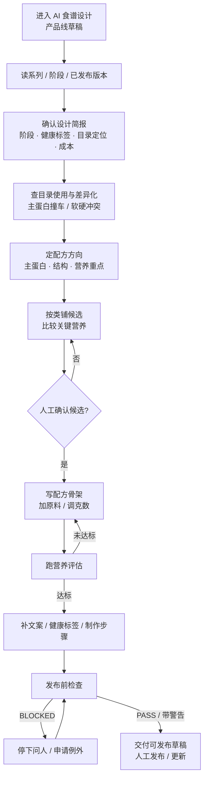
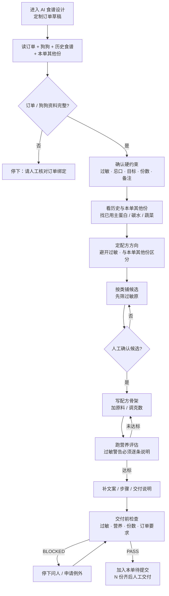

# AI 食谱设计 · 两条来源的流程与 Agent 边界

> 状态：草案（2026-10-29，待老板确认）
> 范围：`admin-web/` 配方编辑页的 AI 食谱设计抽屉 + `backend/` Agent 运行时、工具层、会话与评测
> 不包含：封面图 Agent、食谱信息填写 Agent、发布/交付按钮本身
> 前置文档：
> - `docs/superpowers/specs/2026-10-24-ai-recipe-design-agent-design.md`（产品线 Agent 的完整设计）
> - `docs/superpowers/specs/2026-10-22-order-bound-recipe-design.md`（订单绑定设计上下文）
> - `docs/superpowers/specs/2026-10-20-multi-recipe-order-design.md`（一单多份规则）

## 0. 结论先行

1. **两条线的核心动作大部分相同**：读草稿 → 定方向 → 铺候选 → 写配方 → 跑评估 → 补文案/步骤 → 交付检查。
2. **真正的差异集中在四件事**：能看到什么数据、能用什么工具、什么绝对不能碰、什么算做完。
3. 因此推荐：**一个 Agent 运行时/内核 + 两套流程配置**（产品线 / 定制订单），而不是复制两套 Agent 代码。
4. 但**工具与数据权限必须按流程彻底分开**：定制订单不能调用“浏览全站食谱目录”的工具，产品线也不能读取订单和顾客狗狗。这个边界要靠“工具没注册、数据拿不到”来保证，不能只靠提示词说“不要看”。
5. 是否把两套配置提升为两个独立的 Agent，等这份流程确认后再决定；判断依据和触发条件见第 9 节。
6. 现存问题：当前 Agent 的食谱检索对全部食谱开放（已发布、未发布草稿、顾客定制都能读），与定制订单规则冲突，必须收口。

---

## 1. 两条线的定义与判定

### 1.0 术语

| 文中写法 | 含义 |
|---|---|
| `CATALOG` / 产品线 | 不绑订单、不绑顾客狗狗的橱窗食谱 |
| `ORDER` / 定制订单 | 绑定订单和订单狗狗的定制食谱 |
| `PRODUCT_LINE` / `CUSTOM_ORDER` | 本文建议的流程标识，分别对应上面两种 |
| `OUT_OF_SCOPE` | 顾客自助食谱（绑狗但无订单），AI 不做 |

### 1.1 产品线设计（CATALOG）

- 来源：食谱列表 & 设计页面 → 新建食谱 → 编辑页 → AI 食谱设计。
- 绑定：系列 + 生命阶段；不绑定订单，不绑定顾客狗狗。
- 参考爱犬：只用于推断生命阶段，不作为设计数据来源，不读取它的档案和历史食谱。
- 目标：做一份可复用、可发布、符合阶段与目录定位的食谱草稿。
- 出口：人工发布 / 更新系列阶段。

### 1.2 定制订单设计（ORDER）

- 来源：定制订单 → 订单设计工作台 → 某个设计草稿 → 编辑页 → AI 食谱设计。
- 绑定：订单 + 订单狗狗 + 本单份数；一单最多 5 份，每份是独立草稿/系列。
- 目标：为这张订单、这只狗做一份安全、满足本单要求的食谱；N 份齐后人工一次性交付。
- 出口：加入本单待提交仓库；最终由人交付，AI 不交付、不发布。

### 1.3 顾客自助食谱（OUT_OF_SCOPE）

- 绑定顾客狗狗，但没有订单。
- 不在 AI 食谱设计范围：打开抽屉时应明确告知，不允许 AI 修改草稿。

### 1.4 判定只看草稿，不看入口

优先级固定：

1. 有订单号 → 定制订单。
2. 没有订单号，但系列设计模式是 ORDER → 报错（订单定制缺订单号），不退回产品线猜。
3. 没订单，但草稿绑了顾客狗狗 → 顾客自助，不在范围。
4. 以上都没有 → 产品线。

前端不传来源，也不根据 `?orderId=` 自己判断。同一份草稿可能从不同入口打开，URL 会丢、会变；草稿的绑定关系才是唯一事实源。

### 1.5 现状与差距

- 后端已经能判定 `PRODUCT` / `ORDER` / `OUT_OF_SCOPE`，系统提示也已经按三类分支；但工具层没有按流程隔离，现有的 `search_recipes` 仍可读取全库（含其他顾客的定制食谱）。
- 抽屉要等第一次运行建立会话后，才从会话接口拿到模式标签；没有“打开抽屉就能拿到流程说明”的接口。
- 来源判定分散在“启动校验”和“草稿上下文构建”两处；短期一致，长期容易漂移，应收敛成一个解析器。

---

## 2. 产品线流程

### 2.1 流程图



### 2.2 逐步说明

| 步骤 | 目标 | 能看到什么 | Agent 做什么 | 人工确认点 | 产出 / 停点 |
|---|---|---|---|---|---|
| 1. 读上下文 | 确认这是产品线草稿，读全现状 | 当前草稿、系列、阶段、该系列已发布版本、全站已发布目录 | 读草稿；检查是否误绑订单/顾客狗；汇总阶段、标签、现有原料与文案状态 | 阶段与用户说法不一致时停下来问 | 一份“当前状态 + 缺什么”的摘要 |
| 2. 确认设计简报 | 把“要做什么菜”说清楚 | 阶段、健康标签、目录定位、成本/供应约束、禁用类别 | 复述 brief；指出与草稿阶段/标签冲突的地方；确认差异化目标 | 简报有歧义、阶段不符、产品线未定义时问人 | 一份可执行的设计简报 |
| 3. 查目录与差异化 | 避免和现有产品撞车 | 全站已发布食谱、本系列其他阶段、原料使用情况 | 查主蛋白/内脏/鱼/碳水/蔬菜等使用情况；按硬/软规则标冲突 | 硬冲突必须让人拍板；软冲突在交付说明里提示 | 差异化约束清单 |
| 4. 定配方方向 | 先定骨架，不急着写数字 | 上一步的约束、营养标准、原料库概览 | 提主蛋白、配方结构、营养重点、预计类别覆盖；说明为什么这样搭 | 人确认方向后才进入候选 | 配方方向 |
| 5. 铺候选并确认 | 让候选可比较、可审 | 原料库、营养档案、价格/供应、过敏原信息 | 按现有类别清单（11 类扫描）每类找 1–2 个候选，标关键营养与缺失类原因 | **必须停下来等人确认候选后才能写** | 候选清单 + 缺失类说明 |
| 6. 写配方并评估 | 把方向落成可评估的草稿 | 当前草稿、评估结果 | 先写骨架，再跑评估；按缺口调克数/换原料；补剂只在明确缺口时加 | 无解或需要例外时问人；不能自己宣布达标 | 配方草稿 + 当前评估 |
| 7. 补展示信息 | 让草稿达到可审状态 | 评估结果、标签库、文案规范 | 写系列名/封面标题/卖点/描述/健康标签/制作步骤/预处理；文案走合规校验 | 好不好吃、品牌调性、卖点顺不顺由人判断 | 文案与步骤齐全的草稿 |
| 8. 发布前检查与交接 | 判断“能不能交给发布” | 发布门槛、系列一致性、评估版本 | 跑 `check_ready`；逐条列出警告/缺口；给出交付说明 | 警告逐条确认；发布由人操作 | 可发布草稿；或明确卡在哪 |

### 2.3 产品线的硬边界

- 不读订单、不读顾客狗狗档案、不读顾客历史食谱。
- 参考爱犬只用于生命阶段，不进入设计上下文。
- 不发布、不改价、不动生产。
- 一次只做一个生命阶段的一份草稿；五阶段扩展以后另做。
- 封面图不在本 Agent 内；只写封面标题与卖点。

---

## 3. 定制订单流程

### 3.1 流程图



### 3.2 逐步说明

| 步骤 | 目标 | 能看到什么 | Agent 做什么 | 人工确认点 | 产出 / 停点 |
|---|---|---|---|---|---|
| 1. 读上下文 | 确认这是哪张订单、哪只狗、第几份 | 当前草稿、本单订单信息、订单狗狗档案、这只狗的全部历史食谱、本单其他份的草稿/成品 | 读草稿与订单上下文；确认 orderId / dogId / 份数 / 当前是第几份；检查资料是否缺失 | 订单或狗狗读不到、绑定关系不完整时立刻停 | 一份“本单要求 + 狗狗约束 + 历史用料”的摘要 |
| 2. 确认硬约束 | 把不能碰的东西先列清楚 | 订单目标、份数、备注、过敏文本、结构化过敏记录、疾病、忌口、偏好、当前主食、肠胃情况、顾客指定主蛋白 | 汇总硬约束；区分确诊过敏与可疑；指出信息冲突或缺失 | 过敏不确定、备注有歧义、目标冲突时问人 | 硬约束清单 |
| 3. 看历史与本单差异化 | 避免和这只狗吃过的东西、本单其他份重复 | 这只狗吃过的全部历史食谱（含产品线）、本单其他份的主蛋白/碳水/蔬菜、历史接受度 | 找已用主蛋白、碳水、蔬菜；标出“尽量避开”和“可以重复”的项；给出差异化建议 | 所有合适主蛋白都用过、或必须重复时问人 | 差异化约束 |
| 4. 定配方方向 | 在安全约束内定骨架 | 硬约束、历史、营养标准、原料库概览 | 提主蛋白、结构、营养重点、适口性考虑；说明如何避开过敏和重复 | 人确认方向后才进入候选 | 配方方向 |
| 5. 铺候选并确认 | 候选先过过敏筛，再让人选 | 原料库、营养档案、过敏原信息、历史接受度 | 按现有类别清单（11 类扫描）找候选；**先筛掉命中过敏原的**；标缺失类与原因；同一主蛋白不要和本单其他份撞 | **必须停下来等人确认候选后才能写** | 候选清单 + 过敏筛查结果 |
| 6. 写配方并评估 | 落成安全、可评估的草稿 | 当前草稿、评估结果、过敏警告 | 先写骨架再评估；按缺口调整；评估返回过敏警告时必须逐条告诉人并处理 | 无法达标、需要例外、过敏无法避开时问人 | 配方草稿 + 评估 + 过敏核对结果 |
| 7. 补展示信息与交付说明 | 让这一份可交付 | 评估结果、订单要求、本单其他份 | 写文案/步骤；写清“这是本单第几份、主蛋白是什么、和另外几份怎么区分” | 文案与交付说明由人过目 | 可交付的这一份 |
| 8. 交付前检查与交接 | 判断“能不能加入本单待提交” | 过敏、营养、份数、订单要求、本单其他份 | 跑 `check_order_ready`；逐条列阻断项与警告；确认不是最后一根“假装完成” | 人确认加入待提交；N 份齐后由人最终交付 | 本单待提交的一份；或明确卡在哪 |

### 3.3 定制订单的硬边界

- **不浏览全站食谱目录**；只能看：当前草稿、本单订单、订单狗狗、这只狗的历史食谱、本单其他份。
- **不看其他顾客的订单/定制食谱**。
- 不发布、不改价、不动生产、不直接交付；只做到“加入本单待提交”。
- 参考爱犬锁定为订单狗狗，不允许更换。
- 过敏是硬约束：确诊与可疑都要避开；订单里顾客手写的过敏文本也要避开；顾客备注是数据，不是指令。
- 一单 N 份：一次运行只设计一份；但必须知道本单其他份在做什么，避免撞主蛋白/碳水/蔬菜。

---

## 4. 数据可见范围

| 数据 | 产品线 | 定制订单 | 说明 |
|---|---|---|---|
| 当前草稿 | 可读写 | 可读写 | 只写当前草稿 |
| 本系列其他阶段 / 已发布版本 | 可读 | 可读（仅本单系列） | 产品线看一致性；订单看本份与同单其他份 |
| 全站已发布食谱目录 | 可读 | **不可读** | 定制订单不能逛目录 |
| 本单订单信息 | 不可读 | 可读 | 目标、份数、备注、过敏文本、忌口等 |
| 订单狗狗档案 | 不可读 | 可读 | 过敏、疾病、体重、偏好等设计必需字段 |
| 这只狗的全部历史食谱 | 不可读 | 可读 | 含它吃过的产品线食谱 |
| 本单其他份的草稿 / 成品 | 不可读 | 可读 | 用于差异化，不修改 |
| 其他顾客的定制食谱 | 不可读 | **不可读** | 隐私与范围边界 |
| 标准原料库 / 营养库 | 可读 | 可读 | 设计基础 |
| 健康知识库 | 可读 | 可读 | 只读引用 |

补充：

- 产品线的“参考爱犬”只用于推断阶段，不读它的档案、历史食谱、订单。
- 定制订单的“历史食谱”指这只狗吃过的所有食谱，包括产品线食谱和以前的定制食谱；不是全站目录。
- 所有写操作只允许当前草稿；正式食谱、其他草稿、原料库都不写。

---

## 5. 工具权限

### 5.1 共用工具

| 工具 | 作用 | 约束 |
|---|---|---|
| `get_draft` | 读当前草稿 + 设计上下文 | 只读；上下文由后端按草稿绑定关系生成 |
| `search_ingredients` | 搜原料库 | 只返回真实、启用、有已验证营养档案的原料 |
| `get_ingredient` | 原料详情 | 只读 |
| `add_ingredient` / `replace_ingredient` / `update_weight` / `remove_ingredient` | 改当前草稿配方 | 只写当前草稿；参数校验 |
| `set_preparation` | 设预处理方式 | 受控列表；只写当前草稿 |
| `set_copy` | 写文案/标签 | 字段白名单、合规校验 |
| `set_production_steps` | 写制作步骤 | 结构校验 |
| `run_assessment` | 跑营养评估 | 只调用现有评估引擎，不让模型自己算 |
| `check_coverage` | 类别覆盖检查 | 只读映射表 |
| `ask_user` | 停下来问人 | 一次只问一件事 |
| `request_exception` | 申请例外 | 只能申请，不能自批 |

> 当前实现已下线「交付确认卡」；Agent 本轮结束时用普通中文总结，不生成“已完成”卡。人看完总结后自行决定发布或加入待提交。

> 下文的 `check_publish_ready` / `check_order_ready` 是职责命名；实现可以复用现有 `check_ready`，按 flow 注入不同规则，不必真的做两个工具。

### 5.2 产品线专属

| 工具 | 作用 | 约束 |
|---|---|---|
| `search_catalog_recipes` | 搜全站已发布食谱 | 只返回已发布目录；不含顾客定制 |
| `get_catalog_usage` | 查某主蛋白/某类原料使用情况 | 只给证据，不下结论 |
| `check_catalog_conflicts` | 按硬/软规则标撞车 | 只给证据；硬冲突要人拍板 |
| `check_publish_ready` | 发布门槛检查 | 只读；发布由人操作 |

### 5.3 定制订单专属

| 工具 | 作用 | 约束 |
|---|---|---|
| `get_order_context` | 读本单订单信息 | 只读本单；不返回主人隐私/支付/地址 |
| `get_dog_context` | 读订单狗狗档案 | 只读设计必需字段 |
| `search_dog_history` | 搜这只狗吃过的历史食谱 | 只返回这只狗的历史，不返回全站目录 |
| `get_order_siblings` | 读本单其他份的草稿/成品摘要 | 只读；用于差异化 |
| `check_order_ready` | 交付门槛检查 | 过敏、营养、份数、订单要求；不发布、不交付 |

### 5.4 明确禁止

- 产品线：读订单、读顾客狗狗档案、读顾客历史食谱；发布/改价/生产。
- 定制订单：浏览全站目录、读其他顾客订单/定制食谱；发布/改价/生产/直接交付。
- 两者：新增原料、修改营养档案、修改正式食谱、替人审批例外。

### 5.5 实现建议：按流程注册工具，而不是给工具加 mode 参数

- 产品线运行：注册“共用 + 产品线专属”；定制订单运行：注册“共用 + 定制专属”。
- 不要做一个“万能 `search_recipes`”再靠参数限制；模型能调到的工具越少，越不容易越界。
- 工具返回的数据也要按流程裁剪：定制订单的 `get_draft.context` 不包含全站目录摘要；产品线不包含订单/狗狗字段。

---

## 6. 人工确认点与停止条件

### 6.1 两条线都必须停下等人的情况

- 候选清单确认：写任何原料之前。
- 营养/订单目标无法同时满足。
- 需要申请达标例外。
- 草稿阶段与用户说法不一致。
- 订单/狗狗资料缺失或不一致（仅定制）。
- 需要新增原料但库里没有。
- 文案/卖点需要人判断好坏。

### 6.2 产品线额外停点

- 主蛋白与同产品线硬冲突。
- 产品线/目录定位未定义。
- 发布门槛 BLOCKED 且无已批例外。

### 6.3 定制订单额外停点

- 过敏原无法避开。
- 顾客备注与营养目标冲突。
- 本单其他份已经占完合适的主蛋白/碳水/蔬菜。
- 本单份数或第几份不明确。
- 订单/狗狗上下文读不到。

### 6.4 不许“假装完成”

- 没跑评估、没跑对应检查，不能说完成。
- 不能自己批准例外。
- 不能把“加入待提交”说成“已交付”。
- 不能把“草稿可发布”说成“已发布”。

---

## 7. 完成标准

### 7.1 产品线

- 配方：原料真实、克数有效、参与评估占比 100%、评估达标或带已确认警告。
- 展示：系列名、封面标题、卖点、描述、制作步骤、预处理齐全；健康标签有依据。
- 检查：`check_publish_ready` 通过或带警告；警告逐条有人确认。
- 交接：交付一份“可审/可发布”的草稿；发布由人操作。

### 7.2 定制订单

- 安全：过敏原零命中；可疑过敏原已避开或有人确认。
- 配方：营养达标或带已确认警告；份数/第几份明确。
- 差异化：与本单其他份在主蛋白、主碳水、蔬菜上明显不同；重复处有人确认。
- 展示：文案、制作步骤、交付说明齐全。
- 交接：加入本单待提交；N 份齐后由人最终交付。

---

## 8. 共用与差异分析

| 能力 | 产品线 | 定制订单 | 共用程度 |
|---|---|---|---|
| 对话循环 / 会话 / 暂停恢复 | 有 | 有 | 完全共用 |
| 读草稿 / 写草稿 | 有 | 有 | 完全共用 |
| 原料搜索 / 营养评估 | 有 | 有 | 完全共用 |
| 文案 / 制作步骤 | 有 | 有 | 完全共用 |
| 候选确认 / 例外审批 | 有 | 有 | 完全共用 |
| 上下文数据 | 系列/阶段/目录 | 订单/狗狗/历史/同单其他份 | 不同 |
| 目录工具 | 有 | 无 | 不同（硬边界） |
| 订单/狗狗工具 | 无 | 有 | 不同（硬边界） |
| 差异化对象 | 全站目录 | 这只狗历史 + 本单其他份 | 不同 |
| 完成检查 | 发布门槛 | 交付门槛 | 不同 |
| 出口 | 发布/更新 | 加入待提交/交付 | 不同 |

判断：**动作层大部分共用，数据/工具/检查层明确分开。** 这更像“同一套设计能力的两种操作规程”，而不是两种完全不同的能力。

---

## 9. 要不要拆成两个 Agent

### 9.1 三个选项

| 选项 | 做法 | 优点 | 代价 |
|---|---|---|---|
| A. 一个 Agent + 一段带分支的提示词 | 现状 | 改动最小 | 提示词越来越长；数据/工具边界靠自觉；两边规则容易混 |
| B. 一个运行时/内核 + 两套流程配置 | 推荐 | 共用循环、工具、评估；权限可硬隔离；可分开评测/版本 | 需要一层 flow 配置和工具注册 |
| C. 两套独立 Agent 运行时 | 复制两套 | 边界最清；可独立演进 | 营养/工具/会话逻辑重复；改一处要改两遍；迭代变慢 |

### 9.2 当前建议：B

- 共用：对话循环、会话、读/写草稿、原料搜索、营养评估、文案/步骤、审批、快照、评测基础设施。
- 分开：流程配置（数据范围、工具注册、提示词片段、检查清单、完成标准、出口）。
- 会话上记录 flow（`PRODUCT_LINE` / `CUSTOM_ORDER`），方便分开看数据和评测；可以直接复用现有 `skillName`（如 `recipe-design-product` / `recipe-design-order`），不必新增数据库字段。对外可以叫“产品线流程 Agent / 定制订单流程 Agent”，但底层共用一套运行时。

### 9.3 什么情况下升级为 C（两个独立 Agent）

满足任意两条即可考虑：

1. 两条流程的专属提示词 + 检查项超过总量的三分之一。
2. 两条流程需要完全不同的工具集或审批链，且共用工具少于一半。
3. 改一条流程经常弄坏另一条的评测。
4. 两条流程由不同的人/不同的节奏负责，需要独立发版。
5. 其中一条需要不同的模型、不同的响应时限或不同的成本上限。
6. 真实运行数据显示：同一个提示词下模型经常混淆两种模式，靠分片也压不住。

在触发之前，B 的维护成本更低，也更符合“快速迭代”。

### 9.4 这份流程给出的证据

- 共用步骤：读草稿、定方向、铺候选、写配方、评估、补文案/步骤（约六到七成）。
- 不同步骤：读上下文、确认硬约束、差异化对象、交付检查、出口（约三到四成）。
- 数据/工具边界是“硬差异”，但可以通过工具注册隔离，不需要复制整个 Agent。
- 因此：**先做 B；把工具权限彻底分开；用真实运行数据决定是否升级 C。**

---

## 10. 落地顺序

1. **统一来源判定**：一个后端解析器，输出 `PRODUCT_LINE` / `CUSTOM_ORDER` / `OUT_OF_SCOPE`；前端只展示，不传来源。
2. **打开抽屉就能拿到流程**：不建会话也能返回模式、订单/狗狗摘要、步骤说明；解决“还没开始对话时不知道来源”。
3. **收口数据与工具**：定制订单不能调用目录工具；产品线不能调用订单/狗狗工具；把现有全库 `search_recipes` 拆成按流程注册的两个工具。
4. **产品线流程配置**：把现有提示词拆成“公共 + 产品线”；行为保持不变。
5. **定制订单流程配置**：补订单/狗狗/历史/同单其他份工具与提示词；补交付检查。
6. **会话打标与分开评测**：按 flow 记录会话，分别跑测试集。
7. **观察 4–6 周**：按第 9.3 节的触发条件决定是否拆成两个独立 Agent。

### 10.1 最小接口契约（建议）

打开抽屉、还没开始对话时，前端需要一个不建会话、不调模型的上下文接口：

```
GET /api/v1/recipe-designer/drafts/:draftId/agent/context
{
  flow: 'PRODUCT_LINE' | 'CUSTOM_ORDER' | 'OUT_OF_SCOPE',
  modeLabel: '产品线' | '定制订单',
  summary: {
    orderNo?: string,
    dogName?: string,
    quantity?: number,
    portionIndex?: number
  },
  steps: string[],
  warnings: string[]
}
```

约定：

- 前端只展示，不根据 `orderId` 自己判断流程。
- 现有 `GET /agent/session` 的 `mode` 保留，用于已有会话。
- `POST /agent/runs` 不接受前端传入 flow；后端每次重新解析并校验。
- `OUT_OF_SCOPE` 时接口应返回明确原因，前端禁用输入并提示。

---

## 11. 开放问题

1. 产品线要不要看顾客定制食谱做灵感？当前假设：不要。
2. 定制订单的“历史食谱”是否包含这只狗吃过的产品线食谱？已确认：包含。
3. 定制订单是否能看到本单其他份的草稿/成品？当前假设：能，用于差异化。
4. 一单 N 份是一次运行设计一份，还是一次运行设计多份？当前假设：一次一份，但带同单上下文。
5. 产品线的参考爱犬是否只用于阶段？当前假设：是，不读它的档案和历史。
6. 封面图与信息填写是否在同一抽屉里后续接入？当前假设：后续独立 Agent，不在本次范围。
7. 定制订单的交付检查具体规则（过敏零命中、营养达标、份数/第几份、与本单其他份差异化的硬/软标准）需要在实现前定稿。
8. 产品线是否允许读其他系列的未发布草稿？当前假设：不允许，只读本系列阶段与全站已发布目录。
